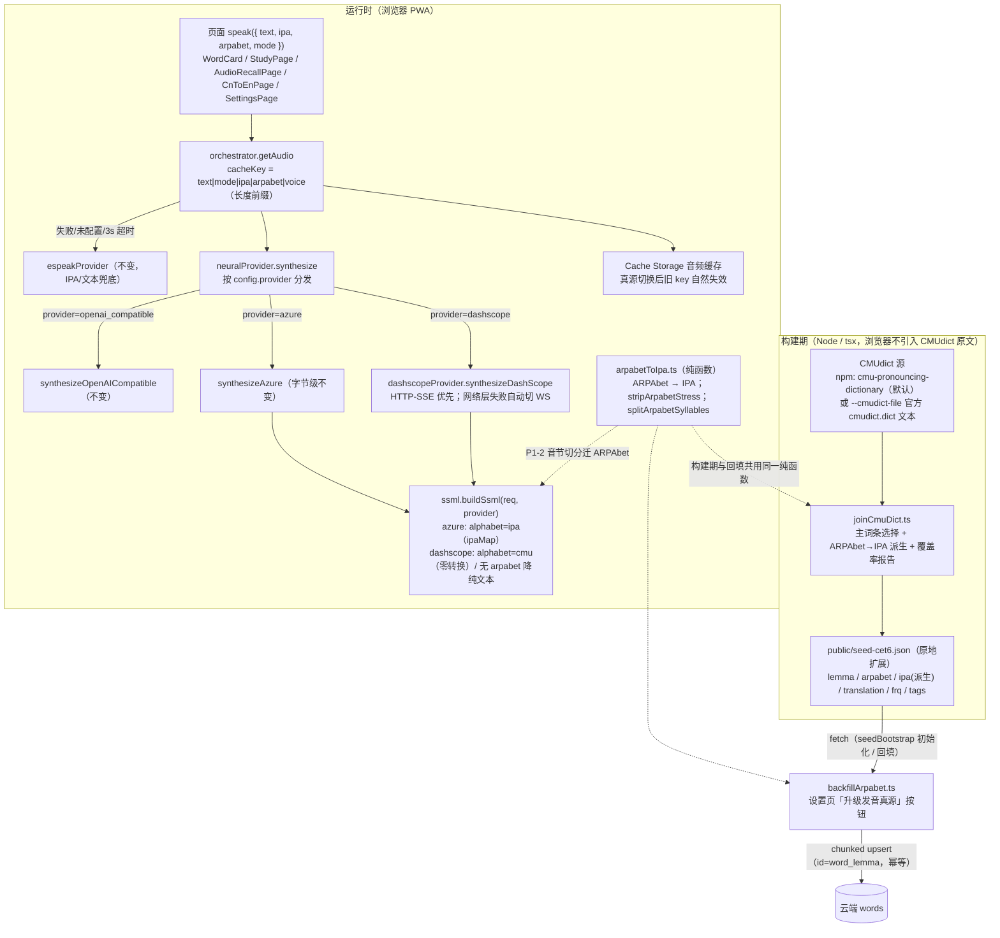
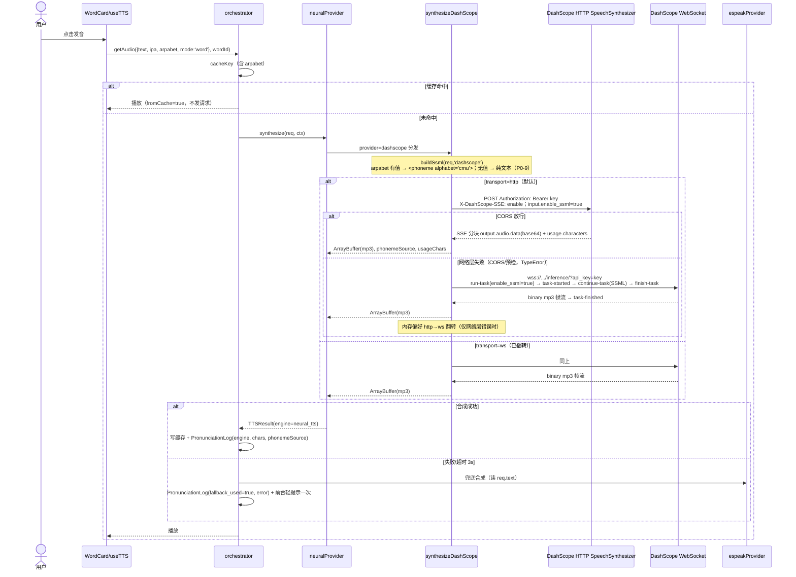
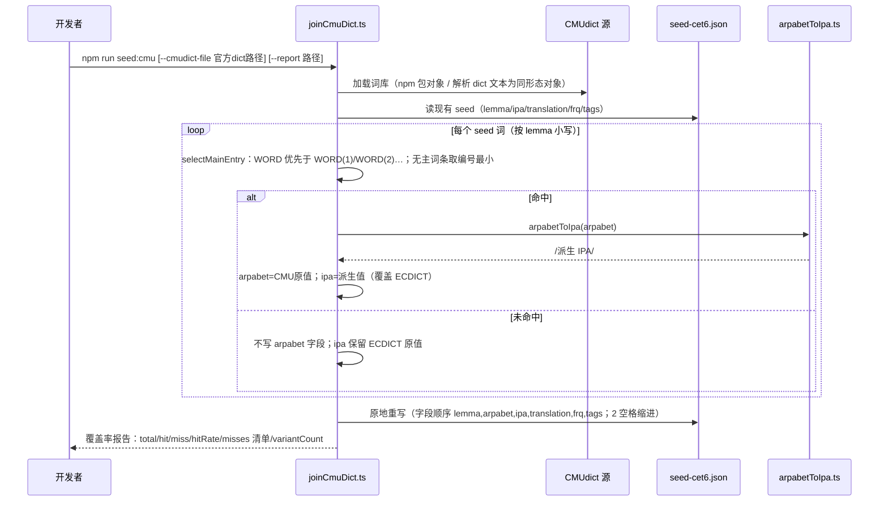
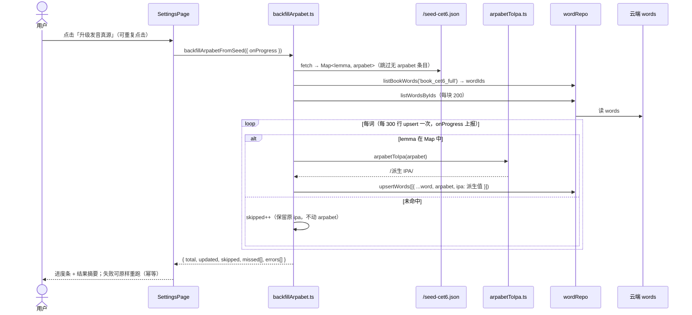
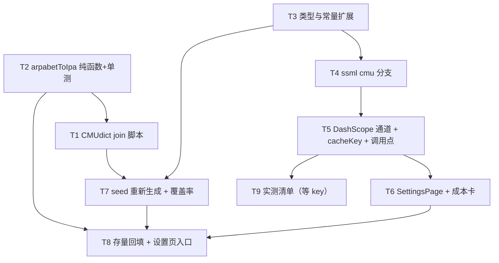

# 架构增量：DashScope 音轨与 CMUdict 发音真源 v0.1

| 项目信息 | 内容 |
|---|---|
| 文档语言 | 中文 |
| 上游输入 | 《PRD增量-DashScope音轨-v0.1.md》v0.1（Q1–Q8 主理人已拍板，见下） |
| 基线文档 | 《架构设计-英语学习进度系统.md》（§1.6 TTS 双轨、§8 密钥例外、第二部分数据模型）｜《PRD-英语学习进度系统.md》§4.5/§6.3 |
| 架构师 | 高见远（Bob） |
| 增量版本 | v0.1（只写增量；基线条款一律沿用，不重述） |
| 变更性质 | 增量：新增 DashScope 主轨 + CMUdict 发音真源；Azure / openai_compatible / espeak 现有行为**零回退**；调度/计划/反馈/反自测**零触碰** |

**主理人拍板直接采用**：Q1 派生 IPA 展示（`Word.ipa` 字段保留、只换值来源，新增 `Word.arpabet?`）；Q2 CMUdict 多变体取主词条；Q6 存量回填入设置页；Q7 音节切分初版纯重音切分；Q8 seed 原地扩展；用户已接受按量付费（约 1~2 元/月）。

---

## 一、增量架构总览



**三条链路的单一真源原则**：

```
CMUdict ARPAbet ──零转换（仅 XML 转义）──→ DashScope <phoneme alphabet="cmu">   ← 发音真源（主轨）
      └── arpabetToIpa.ts（确定性纯函数，可单测）──→ word.ipa                    ← 展示 + espeak 兜底（同源，永不"音标和读出来对不上"）
```

- **展示**：`Word.ipa` 字段与 WordCard / BookPage / AudioRecallPage / CnToEnPage 四处展示逻辑零改动，只是值的来源从 ECDICT 换成派生 IPA。
- **未命中**：CMUdict 无词条 → seed/回填都不写 `arpabet` 字段 → word 模式降级纯文本合成（P0-9），PronunciationLog 标记 `phonemeSource:'text'`，不阻断、不静默。

---

## 二、关键设计决策（D1–D9）

| # | 决策 | 理由与依据 |
|---|---|---|
| D1 | **默认端点用专用 TTS 端点** `https://dashscope.aliyuncs.com/api/v1/services/audio/tts/SpeechSynthesizer`，**不是** brief 中的 `multimodal-generation/generation` | 阿里云官方《非实时语音合成CosyVoice HTTP API参考》（更新 2026-10-10）给出的当前端点即 SpeechSynthesizer，请求体全部参数在 `input` 下（`text/voice/format/sample_rate/enable_ssml/language_hints`）。multimodal-generation 是早期 qwen-audio-tts 的遗留路径（参数在 `parameters` 下）。端点仍走用户可配字段，两种形态都说明（见 §5.6） |
| D2 | **HTTP 通道用 SSE 流式**（`X-DashScope-SSE: enable`），不用非流式 URL | 非流式返回的 `output.audio.url` 是 **http://** OSS 地址（`http://dashscope-result-bj.oss-cn-beijing.aliyuncs.com/...`），HTTPS 页面会被混合内容拦截，且 OSS 的 CORS 未核实；SSE 直接返回 base64 分块（`output.audio.data`），无二次 fetch。保留非流式 JSON 兜底解析（url 二次 fetch 失败即抛错） |
| D3 | **新增 WebSocket 直连通道作为 CORS 不通时的降级（预案 C）**，优先于 brief 的预案 A/B | 官方 demo 仓库 `alibabacloud-bailian-speech-demo/samples/gallery/cosyvoice-js/index.html` 实证：浏览器 `new WebSocket('wss://dashscope.aliyuncs.com/api-ws/v1/inference/?api_key='+apikey)` 可直接鉴权（README 明示"JavaScript 不支持自定义 Header，API Key 需通过 URL 参数传递"）。WebSocket 不受 CORS 预检约束。预案 A（本机网关 openai_compatible）零代码已存在；预案 B（托管转发）尽量不选 |
| D4 | **传输偏好自动翻转**：默认 HTTP-SSE；仅当 HTTP 失败是**网络层错误**（fetch TypeError，无 HTTP 响应）时，当次内尝试 WS 一次，WS 成功则将内存偏好切为 ws；HTTP 4xx/5xx（如 401 错误 key）不翻转 | 避免把瞬时网络故障永久切到 WS；也避免坏 key 时白绕一次 WS。偏好仅内存、不持久化 |
| D5 | **默认 model=cosyvoice-v2，默认 voice=longxiaochun_v2** | 官方《CosyVoice 音色列表》核实结论：**所有专用英文音色（loong*：loongdavid/loongabby/loongemily 等，v2 与 v3 均为）SSML 均"不支持"**；支持 SSML 且能读英文的只有中文系音色（语言标注"中文及中英文混合"/"中文（普通话）、英文"，SSML 支持）。`longxiaochun_v2`（龙小淳，知性积极女）在 v2 列表双处来源确认支持 SSML + 中英混合。备选：`longwan_v2`、`longanwen`、`longyumi_v2`。复刻音色支持 SSML（P2 可复刻一条英文音色） |
| D6 | **派生 IPA 用美式 1:1 映射、不带长度符**（IY→i 而非 iː） | 展示 IPA 必须与发音源（CMU ARPAbet，美式）严格同源：R 一律→r（不做非儿化省略）、ER→ɜr。PRD 示例 `/əˈkæd.ə.miː/` 的长度符为示意；无长度符规则集最小、无歧义。规则集见 §5.2（单测锚点） |
| D7 | **cacheKey 纳入 arpabet**（第 4 段） | 换发音真源必须换缓存 key，杜绝陈旧音频。副作用：全部旧 key 一次性失效（含 Azure 历史缓存），按 LRU 50MB 自然淘汰，不迁移 |
| D8 | **回填幂等键 = 云端 word 文档 id `word_{lemma}` + 确定性字段值** | `arpabet` 来自 CMUdict 主词条（确定性），`ipa` 由同一纯函数派生（确定性）→ 重跑产生同一文档，`upsertMany(onConflict:id)` 即幂等。未命中词保持原 ECDICT ipa 不动 |
| D9 | **P0-7 ph 重音数字开关**：默认保留数字（`ph="S AY1 N"`），常量 `DASHSCOPE_PHONEME_STRIP_STRESS=false`；实测不兼容则翻转常量重新构建 | 官方示例 `ph="S AY N"` 不带数字、CMUdict 实际输出带 0/1/2，兼容性未实测。开关是构建期常量（纯函数 `stripArpabetStress` 已单测），不引入配置 schema 变更 |

---

## 三、数据流详图

### 3.1 DashScope 合成时序（HTTP-SSE 优先 + WS 自动降级）



### 3.2 CMUdict join 构建期管线（T1/T7）



### 3.3 存量云端 words 回填（T8，设置页入口）



---

## 四、文件清单与改动性质

### 4.1 新增（6 个）

| 文件 | 一句话说明 |
|---|---|
| `src/tts/arpabetToIpa.ts` | ARPAbet→IPA 确定性纯函数（映射表 + 重音/音节点规则）+ `stripArpabetStress` + `splitArpabetSyllables`，seed 生成与回填共用 |
| `src/tts/dashscopeProvider.ts` | `synthesizeDashScope`：HTTP-SSE 通道 + WebSocket 通道 + 传输偏好翻转 + DashScope 请求/响应类型与 URL 派生 |
| `src/data/seed/joinCmuDict.ts` | 构建期 join 脚本：CMUdict 源加载、`selectMainEntry` 主词条选择、seed 原地重写、覆盖率报告 |
| `src/data/seed/cmudict-module.d.ts` | `declare module 'cmu-pronouncing-dictionary'` 类型声明（该 npm 包无内置类型） |
| `src/data/backfillArpabet.ts` | 存量回填服务：seed→Map、分块读写、幂等 upsert、进度/结果回调（纯逻辑与 IO 分离，可单测） |
| `src/tts/usageStats.ts` | P1-1 本地用量聚合（localStorage `tts_usage_v1`：本月字符数/请求数/缓存命中数），成本卡数据源 |

### 4.2 修改（15 个）

| 文件 | 改动性质 | 一句话说明 |
|---|---|---|
| `src/types/domain.ts` | 类型扩展 | `TTSProviderName` +`'dashscope'`；`TTSProviderConfig` +`model?: string`；`Word` +`arpabet?: string`；`PronunciationLog` +`chars?: number`、+`phonemeSource?: 'cmu'\|'ipa'\|'text'`（P1-5/P0-9，均为可选字段，反自测锁死不变） |
| `src/config/constants.ts` | 默认值单一来源 | `DEFAULT_TTS_PROVIDER` →`'dashscope'`；新增 DashScope 端点/WS/model/voice/采样率/格式/`language_hints`/ph 重音开关/资费常量/音色选项 |
| `src/tts/types.ts` | 接口扩展 | `TTSRequest` +`arpabet?: string`；`TTSResult` +`phonemeSource?`、`usageChars?`；新增 `PhonemeSource` 类型 |
| `src/tts/ssml.ts` | 扩展分支 | `buildSsml(req, provider='azure')` 增加 provider 参数（默认 azure，旧调用与快照字节不变）；dashscope 分支输出 `<speak>` 根 + `alphabet="cmu"` phoneme（零转换）/ 纯文本降级；word_by_word 词间 `<break time="150ms"/>` |
| `src/tts/neuralProvider.ts` | 扩展分发 | `synthesize` 按 `ctx.config.provider` 三分支（azure 原函数不动；新增 dashscope 分支调用 `synthesizeDashScope`；openai_compatible 原函数不动） |
| `src/tts/orchestrator.ts` | 最小扩展 | `cacheKey` 第 4 段加入 `arpabet`；`PronunciationLogEntry` +`chars?`、`phonemeSource?`（从 TTSResult 透传）；其余流程字节不变 |
| `src/hooks/useTTS.ts` | 透传 + 统计 | log 调用透传 `chars`/`phonemeSource`；接入 usageStats 记录（合成字符/缓存命中）；密钥机制不动 |
| `src/data/repos/configRepo.ts` | 默认初始化联动 | `initDefaultTTSConfig` 预填 `provider=DEFAULT_TTS_PROVIDER`、`endpoint/voice/model` 取 DashScope 默认常量（status 仍 `pending_user_setup`，硬约束 #7 不变） |
| `src/store/useSettingsStore.ts` | 影子副本扩展 | +`ttsModel: string`（默认 DashScope model 常量）；`setTTS(provider, voice, model?)` 第三参可选（旧调用兼容） |
| `src/pages/SettingsPage.tsx` | 增量扩展（**近期成果不回退**） | provider 下拉 +dashscope（azure 加劝退 helper）；endpoint/voice/model 帮助文案按 provider 切换；试听探针带 arpabet；保存 patch 带 model；P1-1 成本卡；T8 回填入口按钮。endpoint 入口/云端写入/试听探针/跨刷新保留开关原样保留 |
| `src/components/word/WordCard.tsx` | arpabet 透传 | `speakWord` 请求加 `arpabet: word.arpabet`（展示逻辑不动） |
| `src/pages/StudyPage.tsx` | arpabet 透传 | 两处 speak 调用加 arpabet 透传 |
| `src/pages/AudioRecallPage.tsx` | arpabet 透传 | 两处 speak 调用加 arpabet 透传 |
| `src/pages/CnToEnPage.tsx` | arpabet 透传 | speak 调用加 arpabet 透传 |
| `src/data/seedBootstrap.ts` | seed v2 透传 | `SeedWord` +`arpabet?: string`；`seedToDocs` 透传 arpabet（ipa 直接用文件内派生值）；导出 `CET6_BOOK_ID` 供回填复用 |
| `src/data/seed/importEcdict.ts` | seed v2 透传 | `SeedWord` +`arpabet?`；`seedToDomainDocs` 透传（与 seedBootstrap 保持一致） |
| `public/seed-cet6.json` | T7 重新生成 | 原地扩展：命中词加 `arpabet`、`ipa` 换派生值；未命中词保留原 ipa、无 arpabet |
| `package.json` | 依赖 + 脚本 | devDependencies +`cmu-pronouncing-dictionary@^2.0.0`（仅构建期）；scripts +`"seed:cmu": "tsx src/data/seed/joinCmuDict.ts"` |

### 4.3 禁碰（硬约束）

`src/scheduler/**`、`src/features/feedback/**`、plan/欠账/降频相关任何文件；`src/tts/espeakProvider.ts`、`src/tts/ipaMap.ts`（Azure 通道依赖，零改动）；反自测规则（Feedback/TrainingRecord/AbilitySnapshot 类型层无 score/accuracy/rating，`FORBIDDEN_SELF_TEST_TERMS` 核对）不变。`DashboardPage` 本期不动（P0-9 的"后台可见"仅落 PronunciationLog + 回填结果摘要，后台 UI 见 §十）。

---

## 五、接口签名

### 5.1 `src/tts/types.ts`（扩展）

```ts
export type PhonemeSource = 'cmu' | 'ipa' | 'text'; // 'cmu'=dashscope 注入；'text'=纯文本降级；'ipa'=预留值（当前无通道写入）

export interface TTSRequest {
  /** 单词/例句原文 */
  text: string;
  /** 完整 IPA（可含 /…/ 斜杠），单词模式必填；展示与 espeak 兜底用 */
  ipa?: string;
  /**
   * 新增：CMUdict ARPAbet（空格分隔，可带 0/1/2 重音数字，如 "AH0 K AE1 D AH0 M IY0"）。
   * dashscope 通道 <phoneme alphabet="cmu"> 零转换直用；缺省 = CMUdict 未命中，word/syllable 模式降级纯文本（P0-9）。
   * azure / openai_compatible 通道忽略本字段。
   */
  arpabet?: string;
  /** mode='syllable' 时该音节的 IPA（不含斜杠） */
  syllable?: string;
  mode: TTSMode;
  voice?: string;
}

export interface TTSResult {
  audio: ArrayBuffer;
  engine: TTSEngine;
  fromCache: boolean;
  /** 实际发送的 SSML（诊断用） */
  ssml?: string;
  /** 新增：音素来源。cmu=dashscope phoneme 注入；text=纯文本降级；ipa=预留值（当前 azure / openai_compatible 通道均不写入，见 §七.3） */
  phonemeSource?: PhonemeSource;
  /** 新增：DashScope usage.characters（P1-1 成本卡精确口径） */
  usageChars?: number;
}
```

### 5.2 `src/tts/arpabetToIpa.ts`（新，纯函数，单测锚点）

```ts
/**
 * ARPAbet → IPA（包斜杠）。严格模式：非法音素/重音数字抛 Error；空串或空白返回 ''。
 * 输入：CMUdict 音素串，空格分隔，音素 = 1~3 个大写字母 + 可选重音 0/1/2（如 "AH0 K AE1 D AH0 M IY0"）。
 */
export function arpabetToIpa(arpabet: string): string;

/** 去重音数字："AH0 K AE1 D AH0 M IY0" → "AH K AE D AH M IY"（P0-7 ph 兼容开关用） */
export function stripArpabetStress(arpabet: string): string;

/** 按音节切分 ARPAbet（P1-2 用；与 IPA 音节点同一套边界规则）："AH0 K AE1 D AH0 M IY0" → ["AH0","K AE1","D AH0","M IY0"] */
export function splitArpabetSyllables(arpabet: string): string[];

/** 音素分类（ssml / 测试共用）：ARPAbet 元音集合判断 */
export function isArpabetVowel(phoneme: string): boolean;
```

**完整映射规则集（工程师照此实现，单测逐条锚定）**

1. **音素表（39 音素，1:1，美式取向、不带长度符）**
   - 元音（15）：`AA→ɑ`｜`AE→æ`｜`AH→ə/ʌ`（见 2）｜`AO→ɔ`｜`AW→aʊ`｜`AY→aɪ`｜`EH→ɛ`｜`ER→ɜr`｜`EY→eɪ`｜`IH→ɪ`｜`IY→i`｜`OW→oʊ`｜`OY→ɔɪ`｜`UH→ʊ`｜`UW→u`
   - 辅音（24）：`B→b`｜`CH→tʃ`｜`D→d`｜`DH→ð`｜`F→f`｜`G→ɡ`｜`HH→h`｜`JH→dʒ`｜`K→k`｜`L→l`｜`M→m`｜`N→n`｜`NG→ŋ`｜`P→p`｜`R→r`｜`S→s`｜`SH→ʃ`｜`T→t`｜`TH→θ`｜`V→v`｜`W→w`｜`Y→j`｜`Z→z`｜`ZH→ʒ`
2. **AH 特殊规则**：`AH0→ə`；`AH1`/`AH2→ʌ`（其余音素不因重音变形）。
3. **重音标记位置规则**：重音 1→`ˈ`、重音 2→`ˌ`，插在**该音节起首辅音簇最左侧**——从带重音的元音出发向左逐个吞噬辅音音素（直到上一个元音或串首），标记插在吞噬簇之前；音节无起首辅音（元音开头）则标记直接插元音前；重音 0 无标记。
4. **音节点（.）规则（最大首辅音近似，Q7）**：每个音节核（元音）之后到下一个音节核之间的所有辅音，全部划归下一音节起首（**不做语音学合法性检查**，P1 升级）；两元音相邻（中间无辅音）→ 点直接插两元音之间；全词只有一个音节核 → 无点。同一位置同时有点与重音标记时顺序为**先点后标记**（写作 `.ˈ`，如 academy 第二音节起点为 `.ˈkæ`，绝不写成 `ˈ.`）。
5. **其他**：token 形如 **1~3 个大写字母 + 可选重音 0/1/2**（ARPAbet 有 16 个**单字母**辅音 `B D F G K L M N P R S T V W Y Z`，长度正则为 `{1,3}` 而非 `{2,3}`，否则单字母辅音全被判非法）；合法性检查须覆盖 `AH`——AH **不在** §5.2 的 39 音素映射表内（走规则 2 的重音特判），**不得**写成「不在表内即非法」而误杀 `AH0/AH1/AH2`；双写辅音**不去重**（`N N→nn`）；`R` 一律→`r`、`ER→ɜr`（不做非儿化省略，保证展示与 CMU 发音源严格同源）；输入先 strip 再按单空格切分；空串/空白→`''`；token 不在合法音素集（39 表 ∪ {`AH`}）或重音数字非 0/1/2 → `throw new Error('arpabetToIpa: invalid phoneme "<tok>"')`（调用方按未命中处理）。

**锚点词表（单测必须逐条覆盖）**：

| 输入 ARPAbet | 期望输出 | 校验点 |
|---|---|---|
| `AH0 K AE1 D AH0 M IY0` | `/ə.ˈkæ.də.mi/` | AH0→ə；最大首辅音：K 归后音节起首；点与重音同位置「先点后标记」→`.ˈkæ`；D 归后音节 |
| `B ER1 D` | `/ˈbɜrd/` | ER→ɜr（R 不省）；单音节无点 |
| `S T R EH1 NG TH` | `/ˈstrɛŋθ/` | 辅音簇起首、重音插簇前；单音节无点 |
| `K AE1 M ER0 AH0` | `/ˈkæ.mɜr.ə/` | 最大首辅音分点；ER0→ɜr（不省 R）；AH0→ə |
| `R IY0 AE1 K T` | `/ri.ˈækt/` | 两元音相邻→点插两元音之间；IY0→i；点后接重音标记 |
| `W IH1 L F AH0 L` | `/ˈwɪ.lfəl/` | 最大首辅音：L F 全归后音节；双写 L 保留 |
| `IY1 G AH0 L` | `/ˈi.ɡəl/` | 元音开头重音直接插元音前；G→ɡ（U+0261）；单辅音 G 归后音节 |
| `K AA2 M P R AH0 HH EH1 N S IH0 V` | `/ˌkɑ.mprə.ˈhɛ.nsɪv/` | 次重音 ˌ；MPR 全归后；HH→h；N S 全归末音节起首 |
| `AH0 N N AE1 CH ER0 AH0 L` | `/ə.ˈnnæ.tʃɜr.əl/` | 双写 N 保留；CH→tʃ；ER0→ɜr；ER0 与 AH0 相邻→点插两元音之间 |
| `HH AH0 L OW1` | `/hə.ˈloʊ/` | 最大首辅音：L 归后音节；OW→oʊ；点与重音同位置 |
| `P R AA1 G R EH2 S` | `/ˈprɑ.ˌɡrɛs/` | 重音 1 插簇前；G R 归后音节；次重音 ˌ；设置页试听探针展示值 |
| `''` / `'   '` | `''` | 空串/空白返回空 |
| `XY1 Z` | throw | 非法音素抛错（严格模式） |

> **锚点表修订（2026-10-13）**：上表「期望输出」已按 §5.2 规则 1–5 逐音节重新推导。此前数行按词典 IPA 排版风格手写，与其自身规则集（尤其规则 4「最大首辅音」）不一致——academy 把 D 归前音节 coda、wilful 把 L 归前音节、react/hello/progress 漏音节点、comprehensive/annual 完全省略音节点、annual 还把 ER0 误映射为 ər。**规则集（规则 1–5）是唯一契约真源，本表是其可复现输出**；若再出现冲突，一律以规则集为准并同步修订本表。
>
> 与 PRD §3.1 示例的偏差：PRD 写 `/əˈkæd.ə.miː/`（带长度符）为示意；本实现取无长度符美式映射（D6），规则更少且与发音源严格同源。`stripArpabetStress('AH0 K AE1 D')` → `'AH K AE D'`；`splitArpabetSyllables('AH0 K AE1 D AH0 M IY0')` → `['AH0','K AE1','D AH0','M IY0']`（与规则 4 最大首辅音一致；原示例 `['AH0','K AE1 D','AH0 M','IY0']` 有误）。

### 5.3 `src/tts/dashscopeProvider.ts`（新）

```ts
/** DashScope 非流式/SSE 响应信封（官方文档形态） */
export interface DashScopeTtsResponse {
  request_id: string;
  output: {
    finish_reason: string | null;   // 'stop' = 合成结束
    type?: string;                  // SSE：'sentence-begin' | 'sentence-synthesis' | 'sentence-end'
    audio: { data: string; url: string; id: string; expires_at: number }; // SSE 分块在 data(base64)；非流式在 url
  };
  usage?: { characters: number };   // 计费字符数（P1-1 口径）
}

/** WS URL 派生：endpoint 主机含 '.maas.aliyuncs.com' → 'wss://{host}/api-ws/v1/inference/'；否则用通用常量 */
export function dashScopeWsUrl(endpoint: string): string;

/** 合成入口（neuralProvider 的 dashscope 分支调用）。超时由内部按 TTS_REQUEST_TIMEOUT_MS 自控（WS 无 fetchWithTimeout） */
export async function synthesizeDashScope(req: TTSRequest, ctx: TTSContext): Promise<TTSResult>;

/** 测试注入点：传输偏好查询/重置（仅内存） */
export function currentTransport(): 'http' | 'ws';
export function resetTransport(): void;
```

**HTTP-SSE 请求**（`fetchWithTimeout`，3s）：

```
POST {config.endpoint}          // 默认 https://dashscope.aliyuncs.com/api/v1/services/audio/tts/SpeechSynthesizer
Authorization: Bearer {apiKey}
Content-Type: application/json
X-DashScope-SSE: enable
{
  "model":  "{config.model ?? 'cosyvoice-v2'}",
  "input": {
    "text": "<speak>…SSML…</speak>",
    "voice": "{config.voice ?? 'longxiaochun_v2'}",
    "format": "mp3",
    "sample_rate": 22050,
    "enable_ssml": true,
    "language_hints": ["en"],
    "rate": 1.0,
    "volume": 50,
    "pitch": 1.0
  }
}
```

**WS 协议**（`wss://dashscope.aliyuncs.com/api-ws/v1/inference/?api_key={apiKey}`，官方 demo 实证）：

- `run-task`：`{header:{action:'run-task',task_id,streaming:'duplex'},payload:{task_group:'audio',task:'tts',function:'SpeechSynthesizer',model,parameters:{text_type:'PlainText',voice,format:'mp3',sample_rate:22050,volume:50,rate:1.0,pitch:1.0,enable_ssml:true,language_hints:['en']},input:{}}}`
- 等 `task-started` → `continue-task`（`payload.input.text` = SSML 全文；**SSML 模式只允许一次 continue-task**）→ `finish-task`
- binary 帧 = mp3 音频分块，按序拼接；`task-finished` 收尾；`task-failed` 读 `header.error_message` 抛错
- `task_id` 用 `crypto.randomUUID()`（不可用时退化为 getRandomValues 手写 v4）
- 每次合成独立连接、收尾即关（单用户低频；官方建议复用连接，此处权衡简单性，P2 可加连接池）
- 安全注记：key 出现在 WS URL query（官方 demo 同款做法，官方已声明泄露风险自担）；本系统 key 存放本就是基线 §8 #2 已声明例外（云端配置文档 RLS owner-only + 运行时内存），此处不扩大暴露面

**传输翻转规则（D4）**：HTTP 抛错且 `err instanceof TypeError`（网络层/CORS，无 HTTP 响应）→ 当次内尝试 WS 一次；WS 成功 → 内存偏好切 `ws`；HTTP 返回 4xx/5xx（有响应）→ 不翻转、直接抛（编排器走 espeak）。

### 5.4 `src/data/seed/joinCmuDict.ts`（新，构建期）

```ts
export interface SeedWordV2 {
  lemma: string;
  arpabet?: string;   // 命中才有；无 = 未命中（P0-9 降级）
  ipa: string;        // 命中 = arpabetToIpa 派生；未命中 = 保留 ECDICT 原值
  translation: string;
  frq: number;
  tags: string[];
}

/** 主词条选择（Q2）：dict 为 CMUdict 形态对象（键含 WORD 与 WORD(1)/WORD(2)…）。WORD 优先；无主词条取编号最小变体 */
export function selectMainEntry(dict: Record<string, string>, lemma: string): string | undefined;

export interface JoinReport {
  total: number; hit: number; miss: number; hitRate: number;
  misses: string[];        // 未命中 lemma 清单
  variantCount: number;    // 使用了编号变体的词数（人工校正候选，P2-2）
}

/** 纯函数部分（可单测）：seed ⋈ CMUdict → 新 seed + 报告 */
export function joinSeedWithCmu(seed: SeedWord[], dict: Record<string, string>): { seed: SeedWordV2[]; report: JoinReport };

// CLI（npm run seed:cmu）：
//   npx tsx src/data/seed/joinCmuDict.ts [--seed public/seed-cet6.json] [--cmudict-file <cmudict.dict 路径>] [--report <输出路径>]
```

**输入输出契约**：
- 输入①：`public/seed-cet6.json`（现有 5407 词：lemma/ipa/translation/frq/tags）。
- 输入②：CMUdict 源。默认 `import cmudict from 'cmu-pronouncing-dictionary'`（npm v2.0.0，ISC，13.4 万词条+变体，仅 devDependency、构建期用，不进浏览器包）；包不可用时 `--cmudict-file` 指向官方 `cmudict.dict` 文本（每行 `WORD  PHONEMES`，构建期解析为同形态小写键对象）。
- 输出①：原地重写 `public/seed-cet6.json`（字段顺序 lemma,arpabet,ipa,translation,frq,tags；2 空格缩进；体积约 +15%）。
- 输出②：覆盖率报告（stdout + `--report` JSON 文件）：要求 CET6 5407 词命中率 ≥99%（PRD G1），未命中清单逐个人工过目。

### 5.5 `src/data/backfillArpabet.ts`（新，运行时）

```ts
export interface BackfillProgress { done: number; total: number; updated: number; skipped: number; }
export interface BackfillResult { total: number; updated: number; skipped: number; missed: string[]; errors: string[]; }

export interface BackfillDeps {
  /** 默认 fetch('/seed-cet6.json')；测试注入 */
  fetchSeed?: () => Promise<SeedWordV2[]>;
  onProgress?: (p: BackfillProgress) => void;
}

/**
 * 存量回填（P0-6）。幂等键 = word.id = `word_{lemma}`（既有约定）；
 * 写入值确定性（CMUdict 主词条 + arpabetToIpa 派生）→ 重跑 = 同文档。
 * 未命中词：保留原 ipa、不写 arpabet（P0-9 语义）。
 */
export async function backfillArpabetFromSeed(deps?: BackfillDeps): Promise<BackfillResult>;
```

流程：`fetchSeed` → `Map<lemma, arpabet>` → `listBookWords(CET6_BOOK_ID)` 取 wordIds → `listWordsByIds` 每块 200 → 逐词计算 patch（命中：`{arpabet, ipa: arpabetToIpa(arpabet)}`；未命中：跳过）→ `upsertWords` 每 300 行一批（全量文档 upsert，merge 语义）→ 进度回调 + 结果汇总（missed 最多留 50 条 lemma + 计数）。

### 5.6 常量与领域类型（T3）

```ts
// src/config/constants.ts（TTS 段）
export const DEFAULT_TTS_PROVIDER: TTSProviderName = 'dashscope';   // 由 'azure' 修改
export const DASHSCOPE_DEFAULT_ENDPOINT = 'https://dashscope.aliyuncs.com/api/v1/services/audio/tts/SpeechSynthesizer';
export const DASHSCOPE_DEFAULT_MODEL = 'cosyvoice-v2';
export const DASHSCOPE_DEFAULT_VOICE = 'longxiaochun_v2';
export const DASHSCOPE_WS_ENDPOINT = 'wss://dashscope.aliyuncs.com/api-ws/v1/inference/';
export const DASHSCOPE_OUTPUT_FORMAT = 'mp3';
export const DASHSCOPE_SAMPLE_RATE = 22050;
export const DASHSCOPE_LANGUAGE_HINTS: readonly string[] = ['en'];
/** P0-7 开关：true = ph 去重音数字（官方示例形态）；默认 false = 保留数字（CMUdict 原值）。实测不兼容则翻转 */
export const DASHSCOPE_PHONEME_STRIP_STRESS = false;
/** P1-1 成本卡资费口径：0.8 元/万字符；新用户开通百炼 90 天内 1 万字符免费 */
export const DASHSCOPE_PRICE_PER_10K_CHARS = 0.8;
export const DASHSCOPE_FREE_QUOTA_CHARS = 10000;
export const DASHSCOPE_VOICE_OPTIONS = [
  { voice: 'longxiaochun_v2', label: '龙小淳（知性女声 · 默认）' },
  { voice: 'longwan_v2', label: '龙婉（普通话女声）' },
  { voice: 'longanwen', label: '龙安温（优雅知性女）' },
  { voice: 'longyumi_v2', label: 'YUMI（正经青年女）' },
] as const;
export const DASHSCOPE_MODEL_OPTIONS = ['cosyvoice-v2', 'cosyvoice-v3-flash', 'cosyvoice-v3-plus'] as const;

// src/types/domain.ts（增量）
export type TTSProviderName = 'azure' | 'openai_compatible' | 'dashscope';
export interface TTSProviderConfig { /* …原字段不动… */ model?: string; }
export interface Word { /* …原字段不动… */ arpabet?: string; }
export interface PronunciationLog { /* …原字段不动… */ chars?: number; phonemeSource?: 'cmu' | 'ipa' | 'text'; } /* 'ipa' 为预留值，当前无通道写入 */
```

**端点二选一说明（D1）**：默认预填通用域名（用户只填 key）；用户在百炼控制台查到 Workspace ID 后可改填业务空间专属域名 `https://{WorkspaceId}.cn-beijing.maas.aliyuncs.com/api/v1/services/audio/tts/SpeechSynthesizer`（官方称性能与稳定性更优，既有域名仍可用）。WS 同理：通用 `wss://dashscope.aliyuncs.com/api-ws/v1/inference/`；Workspace 版 `wss://{WorkspaceId}.cn-beijing.maas.aliyuncs.com/api-ws/v1/inference/`（+api_key query 组合**未核实**，见 §十）。

---

## 六、任务列表（T1–T9，按依赖排序）

> 依赖图见图 6.1。T7/T8 需要真实云端与 seed；T9 等用户 key。每个任务的"改完自检"列在验收标准里。

### T1 CMUdict 获取与 join 脚本（构建期）

- **文件**：`src/data/seed/joinCmuDict.ts`（新）、`src/data/seed/cmudict-module.d.ts`（新）、`package.json`（改）
- **依赖**：T2（join 脚本复用 `arpabetToIpa` 纯函数，单一真源）
- **验收**：① `npm run seed:cmu` 跑通，控制台输出 total/hit/miss/hitRate/variantCount 与未命中清单；② `--cmudict-file` 路径用官方 `cmudict.dict` 文本也能跑通（npm 包不可用时的备选，先联网确认包可安装：`npm i -D cmu-pronouncing-dictionary@2.0.0`）；③ `selectMainEntry` 行为：`WORD` 优先于 `WORD(1)`；只有 `WORD(1)/WORD(2)` 时取编号最小（抽纯函数单测覆盖）；④ 输出 JSON 字段顺序与缩进符合契约；⑤ 脚本不 import 任何 `src/tts/*` 之外的应用代码（避免把云端 SDK 带进构建期）。

### T2 `arpabetToIpa` 纯函数 + 单测

- **文件**：`src/tts/arpabetToIpa.ts`（新）、`tests/tts/arpabetToIpa.test.ts`（新）
- **依赖**：无
- **验收**：① §5.2 锚点表全 13 行全绿（11 个词行 + 空串 + throw）；② `stripArpabetStress`/`splitArpabetSyllables` 各至少 3 例；③ `tsc` 无 unused；④ 函数零 import（纯函数，禁 IO/React/DOM）。

### T3 类型与常量扩展（五处联动）

- **文件**：`src/types/domain.ts`、`src/config/constants.ts`、`src/tts/types.ts`、`src/data/repos/configRepo.ts`、`src/store/useSettingsStore.ts`
- **依赖**：无
- **验收**：① `TTSProviderName` 含 dashscope，`DEFAULT_TTS_PROVIDER==='dashscope'`；② `initDefaultTTSConfig` 新用户预填 endpoint/voice/model（status 仍 `pending_user_setup`，硬约束 #7 单测不回归）；③ `useSettingsStore.ttsModel` 默认取常量；`setTTS(p,v)` 旧签名调用不炸（第三参可选）；④ `npm run test` 全量绿（存量用例对默认值变更的断言如有失败，按"预期变化"更新并注明）。

### T4 `ssml.ts` cmu 分支

- **文件**：`src/tts/ssml.ts`（改）、`tests/tts/ssmlCmu.test.ts`（新）
- **依赖**：T3（provider 类型）
- **验收**：① `buildSsml(req,'dashscope')` word 模式有 arpabet → `<speak><phoneme alphabet="cmu" ph="AH0 K AE1 D AH0 M IY0">academy</phoneme></speak>`（仅 XML 转义）；无 arpabet → `<speak>academy</speak>`（P0-9 降级）；② syllable 模式 dashscope → 纯文本（P0 行为，P1-2 升级）；sentence → `<speak>` 纯文本；word_by_word → 词间 `<break time="150ms"/>`；③ `DASHSCOPE_PHONEME_STRIP_STRESS=true` 时 ph 去数字；④ **azure 路径字节不变**——`tests/tts/tts.test.ts` 四个快照原样通过；⑤ escapeXml 对 `& < > " '` 全覆盖。

### T5 neuralProvider DashScope 通道 + orchestrator cacheKey + 调用点透传

- **文件**：`src/tts/dashscopeProvider.ts`（新）、`src/tts/neuralProvider.ts`（改）、`src/tts/orchestrator.ts`（改）、`src/hooks/useTTS.ts`（改）、`src/components/word/WordCard.tsx`（改）、`src/pages/StudyPage.tsx`（改）、`src/pages/AudioRecallPage.tsx`（改）、`src/pages/CnToEnPage.tsx`（改）、`tests/tts/dashscope.test.ts`（新）
- **依赖**：T3、T4
- **验收**：① provider 三分发，azure/openai 函数体不动；② HTTP-SSE：mock fetch 返回 SSE 文本 → 正确拼接 base64 分块为 ArrayBuffer、解析 `usage.characters`；非流式 JSON（无 SSE content-type）→ 走 url/data 兜底分支；③ WS：mock WebSocket（run-task→task-started→continue-task→finish-task→binary→task-finished）→ 拼接二进制、单次 continue-task、task-failed 抛错；④ 翻转规则：HTTP TypeError → WS 成功 → `currentTransport()==='ws'`；HTTP 401 → 不翻转；⑤ `cacheKey` 含 arpabet：同 text 不同 arpabet key 不同；azure 无 arpabet 时 key 形态符合长度前缀契约；⑥ 编排器 mock neural（dashscope 配置）→ log 带 `phonemeSource`/`chars`；⑦ 四个 UI 调用点 arpabet 透传后 `tsc` 通过；⑧ `tests/qa/ttsAdversarial.test.ts` 全绿（回退链/碰撞/轻提示不回归）。

### T6 SettingsPage：provider/model 下拉 + 帮助文案 + 成本卡（P1-1）

- **文件**：`src/pages/SettingsPage.tsx`（改）、`src/tts/usageStats.ts`（新）
- **依赖**：T3、T5
- **验收**：① 下拉含 dashscope（默认选中）/azure（helper 注明需 VISA/Master、国内不推荐）/openai_compatible；② endpoint/voice/model 的 label/placeholder/helper 按 provider 切换；dashscope 时 endpoint 预填通用端点说明 + Workspace 域名说明；③ 保存 patch 含 model；④ 试听探针请求带 arpabet（`P R AA1 G R EH2 S`），探针结论文案覆盖"主轨没通"的新原因（CORS → 见 T9 结论后的提示语）；⑤ 成本卡：本月字符数/请求数/缓存命中率 + 静态资费说明（0.8 元/万字符、90 天 1 万免费）+ 按月预估；**不显示任何"学了多少分/正确率"形态**（反自测词表核对）；⑥ endpoint 入口/云端写入/试听探针/跨刷新保留开关回归可用。

### T7 seed 重新生成与覆盖率报告

- **文件**：`public/seed-cet6.json`（重新生成）、`src/data/seedBootstrap.ts`（改）、`src/data/seed/importEcdict.ts`（改）
- **依赖**：T1（跑脚本）、T3（SeedWord 类型）
- **验收**：① 执行 T1 脚本重生成 seed；命中率 ≥99%（PRD G1），未命中清单人工过目并记录；② `seedToDocs`/`seedToDomainDocs` 透传 arpabet，ipa 用文件内派生值；③ 新用户初始化后抽查 10 词：云端 word 行含 arpabet、ipa 为派生值；④ 老用户（已初始化）不受影响——seedBootstrap 幂等跳过逻辑不变；⑤ seed 文件仍不进 PWA precache（vite globPatterns 不含 .json，现状不变）。

### T8 存量回填实现 + 设置页入口

- **文件**：`src/data/backfillArpabet.ts`（新）、`src/pages/SettingsPage.tsx`（改，回填按钮）、`tests/data/backfillArpabet.test.ts`（新）
- **依赖**：T2、T3、T6（同文件顺序改）、T7（seed 含 arpabet）
- **验收**：① 「升级发音真源」按钮：进度可见（done/total）、结果摘要（updated/skipped/missed）、失败可原样重跑；② 幂等：连跑两次，第二次 updated 数相同且云端文档值与第一次逐字节一致（deterministic values）；③ 未命中词保留原 ipa、无 arpabet；④ 回填后 PronunciationLog 无异常回退潮（观察 fallback_used 比例）；⑤ 单测覆盖：Map 构建、patch 计算、空 seed、全未命中、重复调用同结果（mock repo + mock fetch）。

### T9 CORS 与带数字重音实测清单（等用户 key）

- **文件**：本文 §九（可执行步骤 + 结果记录表）
- **依赖**：T5（通道代码就绪）；执行前提：用户提供 DashScope API Key
- **验收**：四项各有一条真实请求记录与结论；任一项不通过 → 按 §九的降级动作执行并在本文档记录结果。

### 6.1 任务依赖图



---

## 七、共享知识（跨文件约定）

1. **错误信息语言**：抛错/日志一律英文（`throw new Error('DashScope TTS HTTP 401')`、`[words] upsert failed (code=...)` 延续 repository.ts 现状）；UI 提示与代码注释一律中文。新增错误信息不带"得分/正确率/评级"类词汇（反自测词表）。
2. **缓存 key 规则**：`[text, mode, ipa ?? '', arpabet ?? '', voice ?? '']` 各段长度前缀编码后 `|` 连接（沿用 `lenPrefixed`）。arpabet 进 key = 换发音真源必须换缓存；旧 key 自然失效不迁移。Cache Storage 条目 `x-engine` header 语义不变。
3. **降级标记语义**：`Word` 无 `arpabet` 字段 = CMUdict 未命中 → word/syllable 模式纯文本合成 + `PronunciationLog.phonemeSource='text'`；命中（dashscope 通道注入 cmu phoneme）→ `'cmu'`。**azure 与 openai_compatible 通道保持既有行为、均不写 `phonemeSource`**（受「azure 路径字节不变 / 零回退」硬约束；这两个通道的 `TTSResult.phonemeSource` 恒为 `undefined`；若将来要让它们也标记，需另立任务并同步更新 azure 四个快照与 `tests/tts/dashscope.test.ts:441` 的锁定用例）。`fallbackUsed=true` 语义（主轨失败/未配置/超时 → espeak）完全不变。回填"未命中"同样以"不写 arpabet"表达，无额外布尔字段。
4. **provider 语义**：`dashscope`=主推默认（phoneme cmu 零转换）；`azure`=保留可选、设置页劝退（代码不删）；`openai_compatible`=无 SSML、音标驱动天然降级（现状不变）；`espeak`=兜底轨（零改动）。
5. **传输偏好**：`currentTransport()` 仅内存、不持久化、不写云端；只有"HTTP 网络层错误 + WS 成功"才翻转； rebuild 不影响（默认 http）。
6. **单一真源**：ARPAbet→IPA 只在 `arpabetToIpa.ts` 一处实现；seed 生成（T1）、回填（T8）、未来音节切分（P1-2）共用。禁止在 UI/脚本里另写映射。
7. **命名**：新增文件 camelCase；常量 SCREAMING_SNAKE；DashScope 相关常量统一 `DASHSCOPE_` 前缀；回填/统计等服务模块放 `src/data`、`src/tts`，不新建目录。
8. **幂等键**：word 文档 id = `word_{lemma}`（既有约定）；回填值确定性派生 → upsert 即幂等。音频缓存 key 见第 2 条。
9. **seed 文件契约**：字段顺序固定 `lemma, arpabet, ipa, translation, frq, tags`；`arpabet` 仅在命中时出现；JSON 2 空格缩进；重生成只走 `npm run seed:cmu`，不手改。
10. **默认参数单一来源**：TTS 默认值只在 `constants.ts`；`initDefaultTTSConfig`、settings store、SettingsPage 三处都从常量取，不各写一份。

---

## 八、测试策略

**必须单测（vitest，纯函数优先）**：

| 对象 | 用例 | 文件 |
|---|---|---|
| `arpabetToIpa` | §5.2 锚点表全 13 行（11 词 + 空串 + throw）；`stripArpabetStress`；`splitArpabetSyllables` | `tests/tts/arpabetToIpa.test.ts`（新） |
| `buildSsml` dashscope 分支 | word（有/无 arpabet）/syllable/sentence/word_by_word；ph 开关；escapeXml | `tests/tts/ssmlCmu.test.ts`（新） |
| `buildSsml` azure 分支 | 四模式快照**原样通过**（零回退证据） | `tests/tts/tts.test.ts`（不改） |
| `synthesizeDashScope` | SSE 拼接/usage 解析；非流式 JSON 兜底；WS 协议 mock；task-failed 抛错；传输翻转三态 | `tests/tts/dashscope.test.ts`（新） |
| `cacheKey` | arpabet 进 key；长度前缀无碰撞（voice 含 `|`） | `tests/tts/dashscope.test.ts` 或并入 tts.test.ts |
| 编排器 | mock neural 走 dashscope 配置 → log 带 phonemeSource/chars；回退链不回归 | `tests/tts/tts.test.ts` 扩展 + `tests/qa/ttsAdversarial.test.ts`（不改逻辑，确认全绿） |
| `joinSeedWithCmu`/`selectMainEntry` | 主词条优先、编号最小、未命中、variantCount | `tests/data/joinCmuDict.test.ts`（新） |
| `backfillArpabetFromSeed` | Map 构建、patch 计算、幂等重跑同结果、全未命中、空 seed | `tests/data/backfillArpabet.test.ts`（新） |

**只能等 key 实测（T9）**：浏览器 CORS、`ph` 带重音数字、`<break>`、WS mp3、真实音质与英文听感（P0-8）。

**回归范围（每个任务改完必跑）**：`npm run test`（vitest 全量）+ `npm run build`（`tsc -b` 严格模式 + vite build）。重点看 `tests/tts/`、`tests/qa/ttsAdversarial.test.ts`、`tests/qa/antiSelfTest.test.ts`（反自测：新增字段与文案过 `FORBIDDEN_SELF_TEST_TERMS` 核对；Feedback/TrainingRecord/AbilitySnapshot 类型层仍无 score/accuracy/rating）。

---

## 九、T9 实测清单（可执行步骤，等用户 key）

> 前提：用户在百炼控制台开通 DashScope、创建 API Key；在设置页填 key + 保存（status→active）。以下每条在**部署域名 origin 下**执行（`https://english-progress.app.workbuddy.host`，本地开发用 `http://localhost:5173`），记录"通过/不通过 + 证据（响应摘要/报错）"。

1. **CORS（HTTP-SSE）**：浏览器 Console 执行（key 替换为真实值）：
   ```js
   const r = await fetch('https://dashscope.aliyuncs.com/api/v1/services/audio/tts/SpeechSynthesizer', {
     method: 'POST',
     headers: { 'Authorization': 'Bearer sk-xxx', 'Content-Type': 'application/json', 'X-DashScope-SSE': 'enable' },
     body: JSON.stringify({ model: 'cosyvoice-v2', input: { text: '<speak>hello</speak>', voice: 'longxiaochun_v2', enable_ssml: true, format: 'mp3', sample_rate: 22050, language_hints: ['en'] } }),
   });
   console.log(r.status, r.headers.get('content-type'));
   ```
   - 通过：得到 `200` + `text/event-stream` → HTTP 通道可用，`currentTransport()` 保持 http。
   - 不通过（TypeError / preflight 失败）：自动走 WS（D3/D4 已实现）；若 WS 也不通 → 启用预案 A（设置页切 openai_compatible + 本机网关）并记录。
2. **`ph` 带重音数字**：同一请求把 text 改为 `<speak><phoneme alphabet="cmu" ph="S AY1 N">sin</phoneme></speak>` 与 `ph="S AY N"` 各合成一次，对比音频。
   - 带数字读作 /saɪn/ 且不报错 → 保持默认（保留数字）。
   - 报错 `SSML text is not supported...`/读错 → 翻转 `DASHSCOPE_PHONEME_STRIP_STRESS=true` 重新构建（重音信息丢失，多音节词应力趋平——记录为已知近似）。
3. **`<break>`**：text = `<speak>look<break time="150ms"/>after</speak>` 合成，确认停顿生效且无报错（word_by_word 模式依赖）。
4. **WS mp3**：Console 执行最小 WS 客户端（run-task `format:'mp3'` → continue-task → finish-task），确认收到 binary mp3 帧与 `task-finished`（官方 demo 用 pcm；我们用 mp3，需确认）。
5. **音质与英文听感（P0-8）**：设置页试听 `progress`（arpabet 注入）+ 5 个抽样词（含多音节），确认英文发音可接受、无显著洋腔；不满意按 D5 备选音色逐个试，仍不满意记录给主理人（P2 复刻英文音色路线）。
6. **计费口径核对**：首次合成后读响应 `usage.characters`，与控制台消耗对账一次（确认成本卡口径）。

---

## 十、待明确事项（未核实，不猜）

| # | 事项 | 当前处理 |
|---|---|---|
| 1 | **CORS 是否放行**（HTTP-SSE） | 未实测（T9-1）。设计已按"不通"给出 WS 自动降级（D3/D4）+ 预案 A 文档化 |
| 2 | **`ph` 带重音数字兼容性** | 未实测（T9-2）。默认保留数字 + 构建期开关（D9） |
| 3 | **`<break>` / WS mp3** | 未实测（T9-3/T9-4） |
| 4 | **cosyvoice-v2 单价** | PRD 引用的 0.8 元/万字符为 qwen3-tts / cosyvoice-v3.5-flash 等档位；v2 单价**未核实**，需控制台模型页确认。用户月用量约 2 万字符，价差在元级内，不影响"1~2 元/月"结论 |
| 5 | **qwen-audio-3.x-tts 是否支持 SSML phoneme** | 口径冲突：brief 列表含 qwen-audio-3.x，但官方《SSML 与 LaTeX》（TC 镜像）仅列 5 个 cosyvoice 模型。**未核实** → 保守默认只用 cosyvoice-v2；模型下拉不放 qwen |
| 6 | **Workspace 专属域名 + `api_key` query 组合（WS）** | 未核实。通用域名组合有官方 demo 实证；Workspace 用户若 WS 不通，回退通用域名或走 HTTP（若 CORS 通） |
| 7 | **longxiaochun_v2 英文单音质** | 列表层面确认"支持 SSML + 中英混合"，听感未验证（T9-5） |
| 8 | **未命中词的"后台 Issue 候选清单"UI** | P0-9 的"后台可见"本期只落 PronunciationLog + 回填结果摘要；后台清单 UI 属 P1/P2（与 P2-2 人工校正合并做） |
| 9 | **ECDICT ipa → 派生 ipa 的灰度** | 无开关、直接换值（单人系统，回填可逆：重跑 T1 前的 seed 即可复原来源数据，但云端已覆盖的 ipa 需从备份恢复——建议回填前导一次 words 备份） |

---

## 十一、对 PRD / brief 的发现（偏差说明）

1. **端点更正（D1）**：brief 的 `multimodal-generation/generation` 是早期路径；当前官方文档（2026-10-10 更新）的 CosyVoice 非实时端点是 `/api/v1/services/audio/tts/SpeechSynthesizer`，且参数在 `input` 下而非 `parameters`。本设计按新端点实现，端点字段仍可配。
2. **英文音色结论（D5）**：官方音色列表中**所有专用英文音色（loong* 系列）SSML 均不支持**；"支持 SSML 且有英文能力"的交集只有中文系音色。这是 P0-8 的答案：默认 `cosyvoice-v2` + `longxiaochun_v2`，接受"中文音色读英文"（音素由 CMU 精确驱动）。
3. **PRD §3.1 示例 ipa 带长度符**：本实现用无长度符美式映射（D6），展示与发音源严格 1:1 同源；如需长度符只需改 7 个元音映射值并更新锚点词表。
4. **P1-5（PronunciationLog.chars）随 T5 落地**：字段与 DashScope `usage.characters` 天然配对，提前到主轨任务里做（P1 优先级不变，只是实现位置）。
5. **P0-9 的"不静默"落地口径**：PronunciationLog.phonemeSource='text' + 回填结果摘要；后台 Issue 清单 UI 延后（见 §十 #8）。
