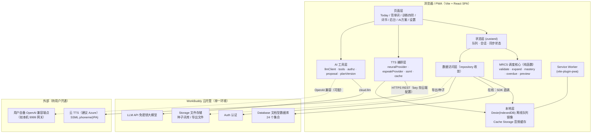
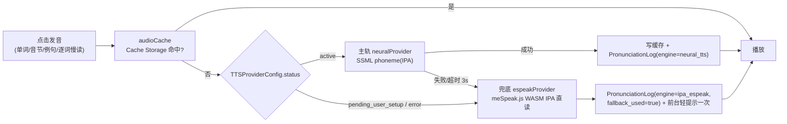
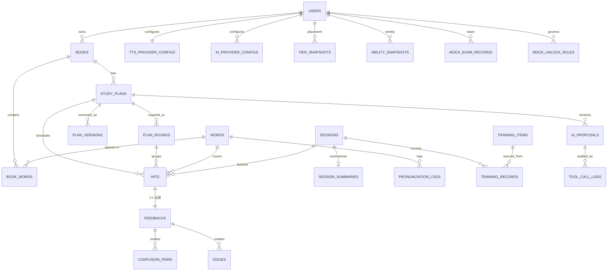
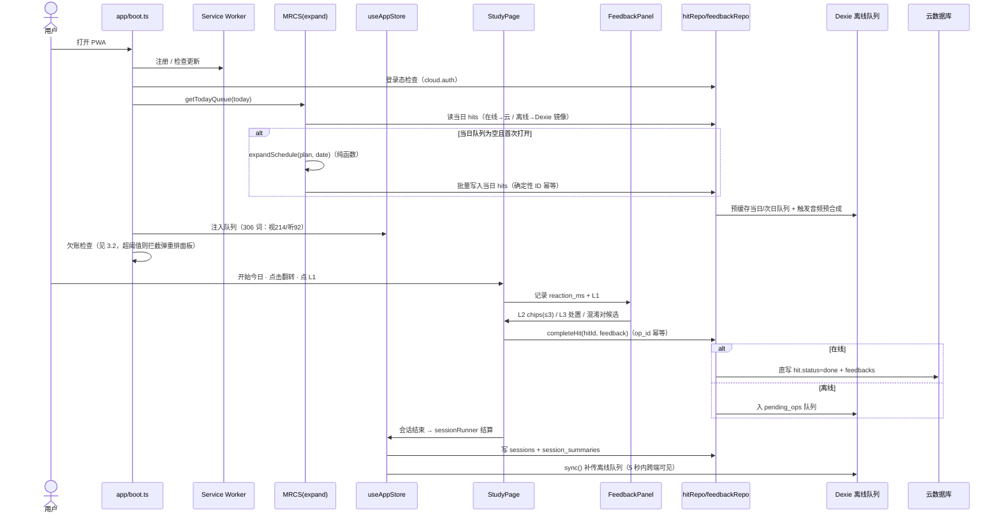
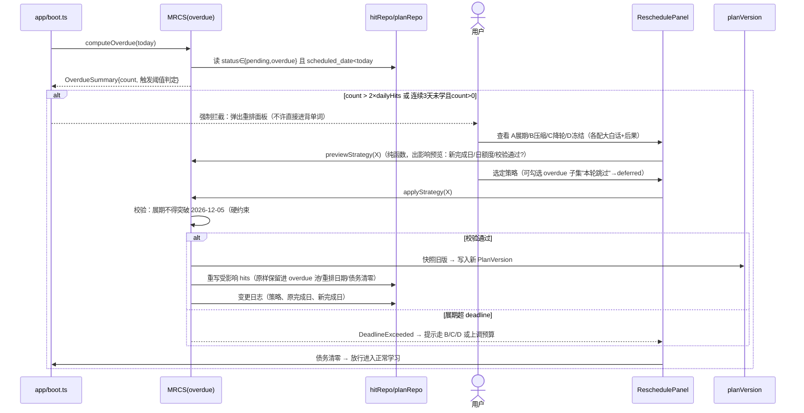
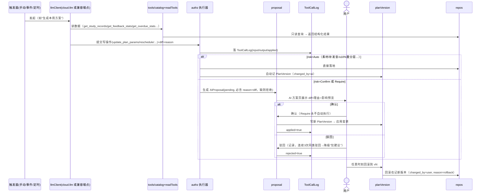
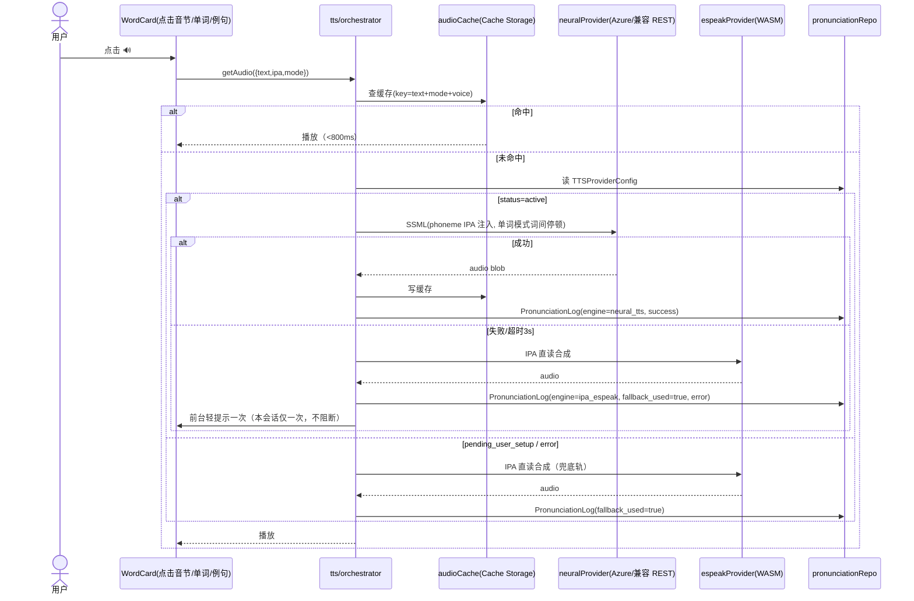
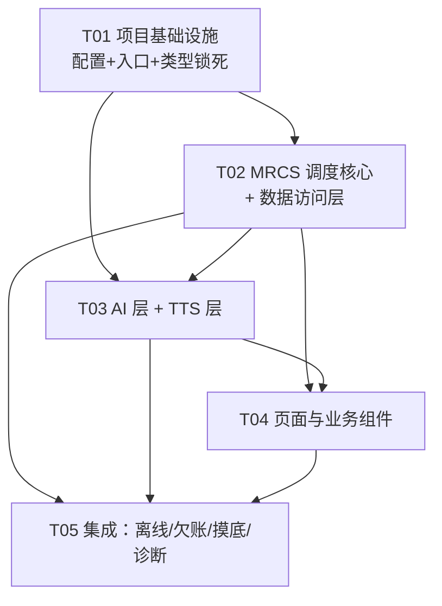

# 架构设计——英语学习进度系统（MRCS v1.0）

| 项目信息 | 内容 |
|---|---|
| 文档语言 | 中文 |
| 上游输入 | 《PRD-英语学习进度系统》v1.0（Q1–Q8 已拍板） |
| 架构师 | 高见远（Bob） |
| 版本 | v1.0 |
| 形态 | Web PWA + WorkBuddy 云托管（`@tencent-ai/workbuddy-cloud-sdk`：auth / database / storage / llm 四模块，纯客户端 SDK，无服务端函数能力） |

---

## 第一部分：实现方案与框架选型

### 1.1 核心技术挑战

| # | 挑战 | 应对 |
|---|---|---|
| 1 | **MRCS 调度器是全系统正确性核心**：时间校验、双档生成、日程展开、模态分配、降频首末轮保底、欠账四策略、deadline 硬约束 | 全部实现为**纯函数模块**（`src/scheduler/`，零 React / 零 DOM / 零 IO 依赖），vitest 单测覆盖每条 PRD 硬约束；调度逻辑严禁进入组件 |
| 2 | **反自测数据层锁死**（PRD §4.8）：Feedback / TrainingRecord / AbilitySnapshot 不得有 score / accuracy / rating 前台通道 | 类型层锁死（TS 类型中物理不存在这些字段）+ 渲染层白名单（诊断报告仅 `DiagReportView` 后台渲染）+ `constants.ts` 禁用词表供 code review 核对 |
| 3 | **双轨插拔 TTS**：神经 TTS 主轨（SSML phoneme/IPA）+ espeak 兜底轨，Provider 可配置端点+key 替换，当前 `pending_user_setup` | `TTSProvider` 接口抽象 + 编排器（缓存→主轨→兜底→日志）+ Cache Storage 音频缓存 |
| 4 | **AI 读写数据 + 三级授权 + 版本回滚** | AI 工具清单收敛为结构化 catalog；执行器按 Auto/Confirm/Require 分级；每次生效写 PlanVersion 快照 + ToolCallLog 审计 |
| 5 | **离线可用**（通勤场景 A）：当日队列 + 音频预缓存，离线 hit 本地排队补传 | Dexie（IndexedDB）本地队列镜像 + Service Worker 预缓存 + 恢复联网自动补传 |
| 6 | **7000 词词库与摸底分层** | ECDICT 裁剪导入脚本（种子数据）；摸底 = ≤300 词分层抽样 + 词频先验 + AI 预估，前两周自动校准 |

### 1.2 整体架构图



**要点**：
- **无自建后端**。沙盒无 MySQL/Redis，数据层一律走云托管文档型数据库（SDK `cloud.database`），全部调用收敛在 `src/data/` 一层，页面与调度器不得直接 import SDK。
- **神经 TTS 不经过 WorkBuddy 云**（云托管无 HTTP 代理能力）：前端直调 Azure/OpenAI 兼容 TTS REST。key 的存放方式见 §8 待明确事项 #2——这是与 SDK "前端不持长期 key" 原则的一处**已声明的例外**，单用户系统可接受。
- **AI 默认通道** = `cloud.llm`（WorkBuddy 免密钥 LLM）；可切换 OpenAI 兼容端点（含用户本机网关），仅切换 baseURL/model/可选 key。

### 1.3 前端结构与架构模式

- **模式**：分层架构（Layered）—— `pages → store/hooks → scheduler(纯函数) / features → data(ai/tts) → cloud SDK`。调度与数据逻辑与 UI 彻底分离。
- **路由**：react-router，底部 5 Tab（Today / 训练 / 词书 / 后台 / 设置）对应 PRD §5.1。
- **样式**：MUI 组件库（表单/对话框/Chips）+ Tailwind 做布局微调；MUI 主题统一色板，诊断口径（后台）与学习口径（前台）视觉分区。
- **状态**：zustand 两个 store（`useAppStore` 会话与队列、`useSettingsStore` 参数与配置），服务端数据经 repository 读写后入 store，不做全局缓存库（单用户规模不需要 react-query）。

### 1.4 数据层设计

- **云文档数据库**：24 个集合（§2.1），按多用户建模但实际单用户；所有查询带 `user_id` 约束（SDK 数据隔离要求）。
- **Repository 收敛**：`src/data/cloud.ts` 是 SDK 唯一初始化点（`publicConfig` 注入 endpoint + publishableKey）；`src/data/repos/*` 按聚合根拆 5 个 repo；禁止页面直接调 SDK。
- **本地镜像与离线队列**（T05）：Dexie 建 `hits_today`（当日队列）、`pending_ops`（离线写操作队列）、`audio_meta`（音频缓存索引）。所有**写操作**统一走 `queue.ts`：在线直写云 + 落本地，离线入 `pending_ops`，`sync.ts` 恢复联网按序补传（幂等：写操作带 `op_id`，hit 文档以确定性 ID 去重，last-write-win）。
- **跨端 5 秒可见**（S30）：会话结束触发即时推送写库 + 对端 `visibilitychange`/轮询（5s）拉取当日队列增量。

### 1.5 LLM 集成层

- `llmClient.ts`：双通道——默认 `cloud.llm.chat.completions`（免密钥）；可切换 OpenAI 兼容端点。统一返回结构化消息。
- `tools/catalog.ts`：PRD §7.1 全部工具的**机器可读清单**（name / 风险级 / 参数 schema / 描述），直接序列化进 LLM 的 tool-calling 请求。
- `authz.ts` 三级授权执行器：
  - **Auto** → 直接落地，写 ToolCallLog；
  - **Confirm** → 生成 `AIProposal`（pending），推用户一键确认/驳回；
  - **Require** → 同 Confirm 但**永不自动执行**（设置项"N 分钟无操作自动执行"仅对 Confirm 生效，默认关闭）。
- `proposal.ts` + `planVersion.ts`：提案必含 `changes(diff)` + `reason`（schema 校验，无理由拒绝落地）；任何计划参数变更（含用户手动改、欠账重排、avg_hit 校准）都生成 `PlanVersion` 完整快照，可回滚到任意版本，回滚本身也记版本。
- 触发方式：手动按钮 / 事件（欠账超阈值、L2 标签激增、混淆对新增、TTS 回退率异常）/ 定时（P1：每日汇总、每周日周度方案）——触发器收敛在 `sessionSummary.ts` 与 `boot.ts`。

### 1.6 TTS 集成层（双轨插拔）



- **`TTSProvider` 接口**（`src/tts/types.ts`）：`synthesize(req: TTSRequest): Promise<TTSResult>`；`TTSRequest = { text, ipa, mode: 'word'|'sentence'|'syllable'|'word_by_word', voice? }`。实现：`neuralProvider`（Azure REST / OpenAI 兼容 TTS，按配置的 provider 字段分发）、`espeakProvider`（本地 WASM，无需联网）。
- **SSML 构造**（`ssml.ts`）：IPA → `<phoneme alphabet="ipa" ph="...">` 注入；单词模式加 `<break>` 词间停顿并禁连读/弱读；例句模式自然韵律 + 逐词慢读按钮；**音节单独点击** = 按 IPA 音节切分生成独立请求。
- **回退逻辑**：主轨失败/未配置/超时 → 自动切 espeak，`PronunciationLog` 落库（engine、fallback_used、error），前台每次会话仅轻提示一次，不阻断学习。
- **当前状态**：`TTSProviderConfig.status = 'pending_user_setup'`（默认值，硬约束），设置页醒目提示"主轨音质待激活"，接口完备、配置即激活。

### 1.7 PWA 与离线策略

| 层 | 缓存内容 | 策略 |
|---|---|---|
| App Shell（SW precache） | HTML/JS/CSS/字体/meSpeak WASM（~2MB） | vite-plugin-pwa 预缓存，版本更新提示 |
| 数据镜像（IndexedDB） | **当日队列**（日期切换时预拉）、今日 hits、当前计划参数 | 每日首次打开时全量拉取当日+次日队列写入 Dexie |
| 音频（Cache Storage） | 当日队列全部单词的 TTS 音频（单词模式 + 例句按需） | 打开 Today 页后台预合成并缓存；espeak 兜底天然离线 |
| 写操作 | 反馈/hit 完成记录 | 在线直写+镜像；离线入 `pending_ops`，恢复后按序补传 |

**离线可用性矩阵**：背单词（见词识意）✅ 全功能｜听词联想 ✅（音频来自缓存/espeak）｜AI 方案 ❌（需网络，置灰）｜欠账重排 ⚠️ 可看不可提交（提交需在线）｜模考 ❌。

### 1.8 PRD §6.3 七条硬约束 → 架构保证映射

| # | 硬约束 | 保证机制（模块级） |
|---|---|---|
| 1 | Feedback / TrainingRecord / MockExamRecord 不得有 score / accuracy / rating 前台通道 | ① `types/domain.ts` 中三个类型**物理不含**这些字段；② 模考诊断报告 `diag_report(json)` 仅 `DiagReportView`（路由在 `/dashboard` 下）渲染，前台组件树中该组件不可达；③ `constants.ts` 维护禁用词表（score/accuracy/rating/正确率/得分/评级），code review 核对 |
| 2 | Hit.status 必含 `overdue` 与 `deferred` | `types/domain.ts` 的 `HitStatus` 联合类型枚举（`pending/done/overdue/deferred`），欠账检测与"显式放弃"均为一等公民路径 |
| 3 | `mastery_decay_enabled` 默认 TRUE | `constants.ts` 的 `DEFAULT_PLAN_PARAMS`；设置页开关可关，关闭后立即恢复全量覆盖并出影响预览 |
| 4 | 调度器：稳固词**首末轮必现**，仅中间轮可跳 | `scheduler/mastery.ts` 纯函数 `skipAllowed(roundNo, R_t) => roundNo !== 1 && roundNo !== R_t`；`expand.ts` 展开时强制调用；`tests/scheduler/mrcs.test.ts` 专测（构造稳固词断言 R_t=2 时永不跳、R_t=3 时仅中间轮可跳） |
| 5 | 展期重排不得突破 deadline | `scheduler/overdue.ts` 的 `applyStrategy('extend')` 返回联合类型：成功 / `DeadlineExceeded`（明确提示只能走 B/C/D 或上调预算）；`tests/scheduler/overdue.test.ts` 专测 |
| 6 | AIProposal 必含 reason 与 changes(diff) | `ai/proposal.ts` 创建提案时 schema 校验，缺 reason 直接抛错拒绝落地（PRD §7.6） |
| 7 | TTSProviderConfig.status 默认 `pending_user_setup` | `data/repos/configRepo.ts` 初始化用户时写入默认配置文档，状态即 `pending_user_setup` |

**附加哲学约束**（PRD §零）：除用户开启的"掌握度降频"外，调度器中**不存在任何**概率/遗忘曲线/自适应组件——MRCS 全程确定性，同参数同输入必产生同日程（轮内乱序用种子=轮次号，可复现）。

---

## 第二部分：数据模型

### 2.1 集合清单（云文档数据库，24 个）

| 集合名 | 实体 | 说明 | 索引 |
|---|---|---|---|
| `users` | User | 单用户系统按多用户建模；`settings(json)` 存通知偏好等非计划参数 | email(unique), phone(unique) |
| `books` | Book | 词书；首本=六级全量 | user_id, status |
| `words` | Word | 词本体（ECDICT 裁剪或导入） | lemma(unique) |
| `book_words` | BookWord | 词书-词关联；**难度层 tier 在此** | (book_id, list_no), (book_id, tier), (book_id, status) |
| `study_plans` | StudyPlan | 复习计划（当前生效版指针） | (book_id, status) |
| `plan_rounds` | PlanRound | 层内轮次窗口 | (plan_id, tier, round_no) |
| `hits` | Hit | 一次覆盖任务（含模态） | (plan_id, scheduled_date), (word_id, scheduled_date), status, **确定性 ID：`{plan_id}_{word_id}_{round_no}_{scheduled_date}`** |
| `sessions` | Session | 学习会话 | user_id, started_at |
| `feedbacks` | Feedback | 每次 hit 一条反馈（**无 score 类字段**） | hit_id(unique), (word_id, created_at) |
| `session_summaries` | SessionSummary | 会话摘要（PRD §4.6 要求，原 §6.1 缺失，本设计补充） | session_id(unique), created_at |
| `confusion_pairs` | ConfusionPair | 形近词混淆对 | (user_id, word_a, word_b) |
| `issues` | Issue | 存疑待处理清单 | (user_id, status, type) |
| `pronunciation_logs` | PronunciationLog | 发音引擎成功/回退日志 | (word_id, created_at), engine |
| `tts_provider_configs` | TTSProviderConfig | TTS 插拔配置（默认 pending_user_setup） | user_id(unique) |
| `ai_provider_configs` | AIProviderConfig | AI 端点配置 | user_id |
| `training_items` | TrainingItem | 训练素材（听词联想/中→英/融会贯通） | type, source, created_by |
| `training_records` | TrainingRecord | 训练记录（**无分数字段**） | session_id, item_id |
| `tier_snapshots` | TierSnapshot | 摸底记录与分层校准 | user_id, calibrated_at |
| `ability_snapshots` | AbilitySnapshot | 周度隐式评估快照（**无总分**） | (user_id, week_start) |
| `mock_exam_records` | MockExamRecord | 模考记录（diag_report 仅后台渲染） | user_id, taken_at |
| `mock_unlock_rules` | MockUnlockRule | 模考解锁规则（AI 制定，用户批准） | (user_id, status) |
| `ai_proposals` | AIProposal | 方案提案（必含 reason+diff） | (plan_id, status) |
| `plan_versions` | PlanVersion | 计划版本快照（回滚用） | (plan_id, version_no desc) |
| `tool_call_logs` | ToolCallLog | AI 工具调用审计 | proposal_id, created_at |

> 音频二进制不进数据库：TTS 音频存 **Cache Storage**（本地）+ **Storage**（可选云端备份例句音频）；种子词库 JSON 文件存 Storage，由导入脚本解析。

### 2.2 关键集合字段详表

**StudyPlan**（版本化的当前状态 + 指针）

| 字段 | 类型 | 说明 |
|---|---|---|
| id, book_id, user_id | string | |
| tier_rounds | `{1:number,2:number,3:number,4:number}` | 各层轮次，推荐档默认 `{1:2,2:2,3:3,4:3}`，保底档全 2 |
| plan_mode | `'recommended'\|'fallback'` | 双档（Q2） |
| start_date, deadline_date, sprint_start_date | string(ISO date) | deadline 默认 `2026-12-05`，硬约束：展期不得突破 |
| daily_budget_min | number | 默认 60（可调 30–120） |
| avg_hit_sec | number | 默认 12，首周真实数据校准（校准走 Auto 级 PlanVersion） |
| gap_min_days | number | 轮间隔下限，默认=轮窗口×0.6 |
| modal_ratio | `{1:number,2:number,3:number,4:number}` | 逐层听觉占比，默认 `{1:0.7,2:0.5,3:0.3,4:0.2}` |
| mastery_decay_enabled | boolean | **默认 true**（Q3） |
| tier_round_days | `Record<string, number[]>` | 逐层逐轮天数（不等分手调） |
| version | number | 当前生效版本号 |
| status | `'draft'\|'active'\|'maintenance'\|'finished'` | maintenance = 实习期维持模式（§4.4.7） |

**Hit**

| 字段 | 类型 | 说明 |
|---|---|---|
| id | string | 确定性 ID（见 2.1），天然幂等、防跨端重复 |
| plan_id, word_id, user_id | string | |
| tier, round_no, list_no | number | 解释性标签（S3"为什么是这些词"直接取用） |
| scheduled_date | string | |
| modality | `'visual'\|'audio'` | 模态分配产物 |
| status | `'pending'\|'done'\|'overdue'\|'deferred'` | 硬约束 #2 |
| completed_at | string? | |
| explain | object | 轮内序号、上次出现信息（可解释性冗余，生成时写入） |

**Feedback**（反自测锁死：**无** score/accuracy/rating）

| 字段 | 类型 | 说明 |
|---|---|---|
| id, hit_id, session_id, word_id, user_id | string | hit_id unique（一次 hit 一条） |
| l1_state | `'instant'\|'recognized'\|'familiar_but_forgotten'\|'unknown'` | 😀秒认/😐认得/😵见过/❌不识（必选单选） |
| reaction_ms | number | 反应时长，隐式评估与 avg_hit 校准输入，**不展示前台** |
| l2_tags | string[]（≤3） | 词义/词形/发音/用法/语境/素材 六类 |
| confusion_word_id | string? | 形近混淆选中的词 |
| l3_actions | string[] | 加练/暂缓/跳过本轮/重点收藏/发音存疑/发音错误/释义例句存疑 |
| note | string(≤60) | 自由备注，供 AI 读取 |
| modality, round_no, tier | string/number | 冗余落库（P0-14 要求每次 hit 完整可下钻） |
| device | `'mobile'\|'desktop'` | 来源端 |

**PlanVersion**：`{ id, plan_id, version_no, snapshot(StudyPlan+PlanRounds 完整 JSON), changed_by('user'|'ai'|'system'), reason, diff_summary, created_at }`

**AbilitySnapshot**（反自测锁死：**无**总分/正确率/评级/预计分数）：`{ id, user_id, week_start, word_states_summary(按状态计数), weak_points(高频想不起词/Top混淆对/L2占比), modality_gap(视觉vs听觉差距曲线数据), tier_pass_rates(各层贯通率), created_at }`

**TTSProviderConfig**：`{ id, user_id, provider('azure'|'openai_compatible'), endpoint, api_key(见待明确#2), voice, ssml_phoneme_enabled, status('pending_user_setup'|'active'|'error'), fallback_engine('ipa_espeak'), last_test_at }`

**MockUnlockRule**：`{ id, user_id, rule_json(信号组合阈值，如 欠账归零天数/稳固率/听觉识别率), status('draft'|'approved'|'active'|'revoked'), created_by('ai'), reason, approved_at }`

### 2.3 ER 图



---

## 第三部分：核心时序图

### 3.1 每日学习流程（打开 → 取队列 → 背词 hit → 反馈 → 落库）



### 3.2 欠账检测与重排流程



### 3.3 AI 提案 → 确认 → 生效 → 回滚



### 3.4 TTS 合成与回退



---

## 第四部分：MRCS 调度器核心设计（TypeScript interface 级，不写实现）

> 全部位于 `src/scheduler/`，**纯函数**：不 import React / DOM / SDK / Dexie；输入输出全为可序列化数据；vitest 全覆盖。

```ts
// ===== src/scheduler/types.ts =====
export type Tier = 1 | 2 | 3 | 4;
export type Modality = 'visual' | 'audio';
export type PlanMode = 'recommended' | 'fallback';
export type HitStatus = 'pending' | 'done' | 'overdue' | 'deferred';

export interface PlanParams {
  tierRounds: Record<Tier, number>;          // 推荐 {1:2,2:2,3:3,4:3} / 保底全2
  planMode: PlanMode;
  startDate: string;                          // ISO date
  deadlineDate: string;                       // 默认 '2026-12-05'，硬约束
  sprintStartDate: string;                    // 默认 '2026-12-05'
  dailyBudgetMin: number;                     // 30–120，默认 60
  avgHitSec: number;                          // 默认 12，首周校准
  gapMinDays: number;                         // 默认 = 轮窗口 × 0.6
  modalRatio: Record<Tier, number>;           // 听觉占比，默认 {1:.7,2:.5,3:.3,4:.2}
  masteryDecayEnabled: boolean;               // 默认 true（Q3）
  tierRoundDays?: Partial<Record<Tier, number[]>>; // 逐层逐轮不等分
  listSize: number;                           // 默认 50
}

export interface TierWordCounts { [t: number]: number } // {1:1750,2:2450,...}

/** 稳固判定（PRD §4.4.4：秒认≥2 且 无L2标签 且 听觉识别≥1）——由 feedbackRepo 聚合后传入 */
export interface WordSteadiness { wordId: string; steady: boolean; }

// ===== validate.ts —— Step 1 时间校验 + 双档生成 + 降级路径（§4.4.6/4.4.7）=====
export interface ValidationInput { params: PlanParams; tierCounts: TierWordCounts; steadyWords: WordSteadiness[]; }
export interface ValidationResult {
  pass: boolean;
  totalHits: number;                          // Σ(W_t×R_t)，降频开启按折减
  dailyHits: number;                          // ceil(totalHits / T)
  dailyMinutes: number;                       // dailyHits × avgHitSec / 60
  marginRatio: number;                        // 与 budget 的余量，±5% 内为"临界"（黄色警告）
}
export function validatePlan(input: ValidationInput): ValidationResult;
export function generateBothPlans(input: ValidationInput): { recommended: ValidationResult; fallback: ValidationResult };
export type DegradePath = 'fallback' | 'freeze_t1' | 'raise_budget' | 'exceed_deadline' | 'maintenance_mode';
export function resolveDegradePath(input: ValidationInput): DegradePath;

// ===== mastery.ts —— 稳固降频 + 首末轮保底（硬约束#4）=====
export function skipAllowed(roundNo: number, tierRounds: number): boolean; // roundNo!==1 && roundNo!==R_t
export function decayedHitsForWord(wordRounds: number, steady: boolean): number; // steady→2，否则 wordRounds
export function isSteadySignal(feedbacks: FeedbackSignal[]): boolean;

// ===== expand.ts —— Step2/3 日程展开：轮次窗口 / 跨List轮转 / 轮内乱序(种子=轮次号) / 模态分配 / gap 约束 =====
export interface QueueEntry { wordId: string; tier: Tier; roundNo: number; listNo: number; modality: Modality; explain: DayExplain; }
export interface DayExplain { roundIdxInWindow: number; lastSeen?: { date: string; roundNo: number; modality: Modality }; }
export function expandDay(params: PlanParams, tierCounts: TierWordCounts, date: string, steadyWords: WordSteadiness[]): QueueEntry[];
export function assignModality(tier: Tier, wordId: string, ratio: number, daySeed: number): Modality;
export function planRounds(params: PlanParams, tierCounts: TierWordCounts): PlanRoundWindow[]; // 各层各轮起止日，校验物理下限

// ===== overdue.ts —— 欠账检测 + 四策略（§4.4.4，硬约束#5）=====
export interface OverdueSummary { count: number; threshold: number; mustReschedule: boolean; }
export function computeOverdue(hits: HitRecord[], today: string, dailyHits: number, lastStudyDate?: string): OverdueSummary;
export type RescheduleStrategy = 'extend' | 'compress' | 'drop_round' | 'freeze';
export interface StrategyPreview { strategy: RescheduleStrategy; plainWords: string; newFinishDate: string; newDailyHits: number; validation: ValidationResult; affectedWordCount: number; }
export type StrategyOutcome = { ok: true; newPlan: PlanParams; hitMutations: HitMutation[] } | { ok: false; error: 'DeadlineExceeded' };
export function previewStrategy(s: RescheduleStrategy, input: ValidationInput, overdue: HitRecord[]): StrategyPreview;
export function applyStrategy(s: RescheduleStrategy, input: ValidationInput, overdue: HitRecord[], deferredIds?: string[]): StrategyOutcome;

// ===== preview.ts —— 参数影响预览（P0-09，S2）=====
export function impactPreview(oldP: PlanParams, newP: PlanParams, tierCounts: TierWordCounts, steadyWords: WordSteadiness[]): { totalHitsDelta: number; dailyMinutes: ValidationResult; newFinishDate: string; passChanged: boolean; }
```

**关键正确性断言（单测必测）**：
1. 稳固词在 R_t=2 时任何轮都不跳；R_t=3/4/5 时仅第 2..R_t-1 轮可跳（硬约束#4）。
2. `masteryDecayEnabled=false` 时 totalHits = Σ(W_t×R_t) 严格全量。
3. 展期结果 finishDate ≤ deadline，否则返回 `DeadlineExceeded`（硬约束#5）。
4. 同参数同输入 expandDay 输出逐字节一致（确定性，种子=轮次号）。
5. 模态分配：每层实际听觉 hit 数 / 总数 ≈ modal_ratio[t]（±1 词容差）。
6. gap 约束：同词相邻 hit 间隔 ≥ gapMinDays，冲突时顺延到最近合法日。
7. 欠账阈值：count > 2×dailyHits 或 连续3天未学且 count>0 → mustReschedule=true。

---

## 第五部分：任务列表（工程师照此实现）

> 共 5 个任务、约 70 个源文件（含测试；P0 范围大，略超最初 25–45 预估）。每个任务有独立验收标准，T01 完成后 T02/T03 可并行，T04 依赖 T02+T03，T05 收口集成。

### T01 项目基础设施（P0，无依赖）

产出文件：
```
package.json                      # 依赖与脚本（dev/build/test/preview）
vite.config.ts                    # vite + react + tailwind + vite-plugin-pwa（manifest/ precache 配置）
tsconfig.json                     # strict 模式
tailwind.config.ts                # 含 postcss 内联配置
index.html                        # PWA 入口，meta theme-color
public/manifest.webmanifest       # 名称/图标/standalone
src/main.tsx                      # 挂载入口
src/App.tsx                       # 路由 + 底部 5 Tab Layout（Today/训练/词书/后台/设置）
src/app/theme.ts                  # MUI 主题（前台学习口径 / 后台诊断口径两套色板变量）
src/config/constants.ts           # DEFAULT_PLAN_PARAMS（avg_hit=12, deadline=2026-12-05, modal_ratio 默认, mastery_decay=true, TTS status=pending_user_setup）+ 反自测禁用词表 + 欠账阈值倍数
src/types/domain.ts               # 全部领域类型与枚举（Tier/Modality/HitStatus/L1State/L2Tag/L3Action/各实体接口——硬约束#1/#2 在此物理锁死）
src/styles/global.css             # Tailwind 入口 + 全局
```
依赖任务：无。
**验收标准**：`npm run dev` 可启动并渲染 5 Tab 空壳；`npm run build` 通过；`npm run test`（vitest 空跑）通过；PWA manifest 可被 Lighthouse 识别；`types/domain.ts` 中 Feedback/TrainingRecord/AbilitySnapshot 类型经 grep 确认无 score/accuracy/rating 字段。

### T02 MRCS 调度核心 + 数据访问层（P0，依赖 T01）

产出文件：
```
src/scheduler/types.ts            # 上文 §4 全部接口
src/scheduler/mastery.ts          # 稳固判定 / 降频折减 / skipAllowed（硬约束#4）
src/scheduler/validate.ts         # Step1 时间校验 + 双档生成 + 降级路径 resolveDegradePath（含维持模式）
src/scheduler/expand.ts           # Step2/3 轮次窗口/跨List轮转/轮内乱序/模态分配/gap 约束/DayExplain
src/scheduler/overdue.ts          # computeOverdue + 四策略 preview/apply + deferred 子集（硬约束#5）
src/scheduler/preview.ts          # impactPreview 参数影响预览
src/scheduler/index.ts            # barrel
src/data/cloud.ts                 # SDK 唯一初始化（publicConfig 注入，禁止他处 import SDK）
src/data/collections.ts           # 24 集合名与文档类型映射
src/data/repository.ts            # 通用 CRUD/分页/条件查询封装
src/data/repos/wordRepo.ts        # books/words/book_words + ECDICT 查询
src/data/repos/planRepo.ts        # study_plans/plan_rounds/plan_versions 读写
src/data/repos/hitRepo.ts         # hits 批量写入/当日查询/状态迁移/幂等 upsert
src/data/repos/feedbackRepo.ts    # feedbacks/sessions/confusion_pairs/issues/pronunciation_logs/session_summaries + 稳固信号聚合(isSteady 输入)
src/data/repos/configRepo.ts      # tts/ai 配置 + snapshots（初始化默认 TTSProviderConfig，硬约束#7）
src/data/seed/importEcdict.ts     # 六级 7000 词裁剪导入（Storage 种子 JSON → words/book_words）
tests/scheduler/mrcs.test.ts      # §4 七条正确性断言（首末轮必现/确定性/模态比例/gap/deadline）
tests/scheduler/overdue.test.ts   # 四策略 + 阈值触发 + DeadlineExceeded
```
依赖任务：T01。
**验收标准**：① 两档计划敏感性算术与 PRD §4.4.6 表一致（推荐 16800 hits@25/35/25/15、保底 14000）；② 上述两条测试全绿；③ 用种子数据在云数据库建集合并读写回验通过；④ `skipAllowed(1,R)=skipAllowed(R,R)=false` 对任意 R。

### T03 AI 层 + TTS 层（P0，依赖 T02）

产出文件：
```
src/ai/llmClient.ts               # 双通道：cloud.llm（默认）/ OpenAI 兼容端点（可测连通性）
src/ai/tools/catalog.ts           # PRD §7.1 全工具机器可读清单 + 三级风险标注
src/ai/tools/readTools.ts         # 10 个只读工具实现（走 repos 只读）
src/ai/tools/writeTools.ts        # 15 个写工具实现（全部经 authz 分发）
src/ai/authz.ts                   # Auto/Confirm/Require 执行器（Require 永不自动执行）
src/ai/proposal.ts                # 提案创建（schema 强制 reason+diff，硬约束#6）/确认/驳回/采纳率统计
src/ai/planVersion.ts             # PlanVersion 快照/回滚（回滚也记版本）
src/ai/prompts.ts                 # 系统提示词（含工具清单注入与"无理由拒绝落地"约束）
src/tts/types.ts                  # TTSProvider 接口 + TTSRequest/TTSResult
src/tts/ssml.ts                   # IPA→phoneme SSML 构造（单词禁连读/例句自然/逐词慢读/音节切分）
src/tts/neuralProvider.ts         # Azure REST / OpenAI 兼容 TTS（按 provider 字段分发）
src/tts/espeakProvider.ts         # meSpeak.js(espeak-ng WASM) IPA 直读
src/tts/orchestrator.ts           # 缓存→主轨→兜底→PronunciationLog→轻提示一次（§1.6 流程）
```
依赖任务：T02。
**验收标准**：① AI 走免密钥通道完成一次"读数据→提案→（Confirm 级）确认→生效→回滚"闭环，ToolCallLog 全程可查；② 无 reason 提案被拒绝；③ TTS：配置留空时 espeak 正常出声且 pronunciation_logs 记录 fallback_used=true；模拟 Azure 配置后主轨生效并缓存；断网时缓存命中仍可播放。

### T04 页面与业务组件（P0/P1，依赖 T02、T03）

产出文件：
```
src/store/useAppStore.ts          # 当日队列/会话/同步状态
src/store/useSettingsStore.ts     # 计划参数/模态比例/TTS·AI 配置缓存
src/hooks/useTTS.ts               # 播放 hooks（点击<800ms 体验：预取下一词）
src/hooks/useFeedback.ts          # L1→L2→L3 提交编排 + reaction_ms 计时
src/components/word/WordCard.tsx      # IPA 常驻（≥单词 60% 字号）+ 音节可点听 + 翻转
src/components/feedback/FeedbackPanel.tsx  # L1 四选一单点即走 / L2 chips≤3 / L3 处置
src/components/feedback/ConfusionPicker.tsx # 形近混淆候选 Top5（拼写相似度）
src/components/plan/PlanSummaryCard.tsx     # 各层轮次/当前轮/List 进度（G1 一屏可答）
src/pages/TodayPage.tsx           # §5.2 线框：开始今日(词数+模态构成)/欠账横幅/诊断摘要（无打卡无圆环）
src/pages/StudyPage.tsx           # 背单词页（见词识意，§5.3 线框）
src/pages/TrainingPage.tsx        # 训练选择页（§5.4 线框，模考锁定态灰置）
src/pages/AudioRecallPage.tsx     # 听词联想：自动播音频+3秒计时环+超时自动😵可修正+零分数展示
src/pages/CnToEnPage.tsx          # 见中文联想英文：产出→翻转自查→L1
src/pages/BookPage.tsx            # 词书管理（§5.5）：分层视图/增删词/批量移动/层级手调/导入入口
src/pages/PlanEditorPage.tsx      # 计划编辑：双档生成+时间校验+影响预览联动（改参数 2 秒内重排）
src/pages/DashboardPage.tsx       # 后台（§5.6）：各层进度/欠账/反馈分布/视觉听觉差距/薄弱点/待处理清单/完整记录下钻——渲染层白名单，无总分正确率
src/pages/AiPlanPage.tsx          # AI 方案页（§5.7）：提案 diff+理由+影响预览/变更日志/回滚/AI 有效性面板
src/pages/SettingsPage.tsx        # 设置（§5.8）：TTS 配置(pending 提示)/调度参数/降频开关/AI 端点/训练开关
```
依赖任务：T02、T03。
**验收标准**：① 按页面逐条对照 PRD §3 用户故事 S1–S29 与 §5 线框验收；② 前台（Today/背单词/训练）DOM 中 grep 不到"正确率/得分/评级/连续/徽章"（禁用词表核对）；③ L1 单次点击完成并跳下一词；④ 音标常驻且可点发音 <800ms（缓存命中路径）。

### T05 集成：离线 / 欠账 / 摸底 / 会话 / 诊断（P0/P1，依赖 T02、T03、T04）

产出文件：
```
src/offline/localDb.ts            # Dexie schema：hits_today / pending_ops / audio_meta
src/offline/queue.ts              # 写操作统一入口（在线直写+镜像 / 离线排队，op_id 幂等）
src/offline/sync.ts               # 恢复联网按序补传 + 5 秒跨端可见轮询
src/offline/precache.ts           # 当日队列镜像 + 音频预合成触发
src/app/boot.ts                   # 启动序列：SW注册→登录→当日队列→欠账检查(拦截)→预缓存
src/features/overdue/OverdueGuard.tsx      # 欠账拦截路由守卫（不许直接进背单词）
src/features/overdue/ReschedulePanel.tsx   # 四选一面板：大白话原文+后果预览+deferred 子集勾选
src/features/placement/PlacementWizard.tsx # 摸底向导：≤300 词抽样+作答+AI 预估分层+批量>10%需确认
src/features/session/sessionRunner.ts      # 会话生命周期（开始/中断恢复/结算）
src/features/session/sessionSummary.ts     # 会话摘要生成 + 触发器（事件类：欠账超阈值/L2激增/混淆对≥5/TTS回退异常）
src/features/diagnosis/abilitySnapshot.ts  # 周度快照：词级状态/薄弱点/模态差距曲线（无总分）
src/features/mock/mockUnlock.tsx           # 模考锁定态 + 解锁规则评估（AI 制定→批准→active）
src/features/mock/DiagReportView.tsx       # 模考诊断报告（仅后台路由可达）
tests/integration/dailyFlow.test.ts        # 端到端：建计划→展开→完成3个hit→反馈落库→稳固判定→降频生效
```
依赖任务：T02、T03、T04。
**验收标准**：① 断网完成 10 个 hit → 恢复联网 30 秒内补传成功、云端无重复（幂等验证）；② 国庆场景模拟：制造 5 天欠账 → 重开强制弹面板 → 四策略预览正确 → 选 B 压缩后债务清零；③ 摸底 300 词产出 T1–T4 分层且批量>10% 时弹确认；④ 模考入口默认锁定且解锁规则走 Confirm 级提案；⑤ 端到端测试全绿。

### 任务依赖图



---

## 第六部分：依赖包列表

```
# 运行时
react@^18.3 / react-dom@^18.3           # UI 框架
react-router-dom@^6                     # 路由
@mui/material@^5 + @emotion/react + @emotion/styled   # 组件库
tailwindcss@^3                          # 布局微调
zustand@^4                              # 状态管理（轻量，两个 store）
dexie@^4                                # IndexedDB 离线队列
dayjs@^1                                # 日期（ISO 处理）
papaparse@^5                            # CSV 导入（P0-05）
recharts@^2                             # 后台差距曲线/分布图（诊断口径）
mespeak@^2 (或 espeak-ng WASM 等价包)    # espeak 兜底轨（待明确#3 确认选型）
@tencent-ai/workbuddy-cloud-sdk@dev     # 云托管 SDK（auth/database/storage/llm）

# 构建与测试
vite@^5 + @vitejs/plugin-react          # 构建
vite-plugin-pwa@^0.20                   # SW/manifest/precache（内置 workbox）
typescript@^5                           # 类型
vitest@^2                               # 单测（调度器纯函数 + 集成）
```
> 刻意**不引入**：react-query（单用户无复杂服务端缓存需求）、openai SDK（fetch 直调兼容端点即可）、redux（过重）。

---

## 第七部分：共享知识（跨文件约定）

1. **目录结构**：`src/scheduler`（纯函数，禁 IO/React）、`src/data`（云 SDK 收敛层，页面禁直接 import SDK）、`src/ai`、`src/tts`、`src/features`（业务流程）、`src/pages`+`src/components`（纯展示+hooks）、`src/store`、`src/offline`、`src/types`、`src/config`、`tests`。
2. **边界铁律**：调度逻辑只存在于 `src/scheduler`（纯函数）——组件只调用不实现；云 SDK 只在 `src/data/cloud.ts` 初始化；TTS 供应商细节只在 `src/tts/*`。
3. **命名**：集合名 snake_case 复数；TS 类型 PascalCase；文件名与默认导出同名的组件用 PascalCase，其余 camelCase。
4. **日期**：一律 ISO 8601 字符串（`YYYY-MM-DD` 为计划日，时间戳 UTC）；调度器内部只接受 date 字符串。
5. **ID 约定**：hit 用确定性 ID `{plan_id}_{word_id}_{round_no}_{scheduled_date}`（幂等 + 防跨端重复）；其余实体用云 SDK 生成的 id；离线操作带 `op_id`（uuid）。
6. **反自测禁用词表**（`constants.ts`）：`score / accuracy / rating / 正确率 / 得分 / 评级 / 掌握度百分比 / 连续天数 / 徽章` —— 前台组件与 Feedback/TrainingRecord/AbilitySnapshot 类型中禁止出现；模考 diag_report 仅 `DiagReportView`（后台路由）渲染。
7. **三级授权语义**：Auto=直接落地+日志；Confirm=提案待确认（可配超时自动执行，默认关）；Require=永不自动执行。
8. **默认参数单一来源**：所有默认值只在 `src/config/constants.ts` 一处（avg_hit=12、deadline=2026-12-05、modal_ratio、mastery_decay=true、TTS pending_user_setup、欠账阈值 2×）。

---

## 第八部分：待明确事项（工程师开工前必须敲定，≤6）

| # | 事项 | 影响 |
|---|---|---|
| 1 | **云数据库能力 spike**：复合索引/分页/事务边界需半天验证（SDK 文档型 CRUD 的查询表达力决定 hitRepo 查询写法） | T02 开工前 |
| 2 | **神经 TTS 调用通路与 key 存放**：云托管无服务端代理 → 前端直调 Azure REST，key 存云端用户配置文档、运行时取入内存（不入 localStorage/代码）。单用户系统接受此风险；或用户提供本机网关作 openai_compatible 通道 | T03 开工前 |
| 3 | **espeak 兜底选型**：meSpeak.js（espeak-ng WASM，~2MB，随包预缓存、离线可用）——确认包体积可接受 | T01/T03 |
| 4 | **ECDICT 种子数据**：7000 词裁剪范围（IPA/释义/词频必备；例句是否随包影响预缓存量）与获取文件 | T02 |
| 5 | **摸底抽样参数**：≤300 词按词频分层的抽样配比（生词候选加权）、前两周自动校准触发频率（每日/每会话） | T05 |
| 6 | **听觉 hit 的 P0 音频来源**：R7 真题原声未定 → P0 全部走 TTS 合成；预缓存按"当日队列全部单词音频"预生成（约 300 词/天 × 音频体积需确认配额） | T05 |

---

## 附录：对 PRD 的发现（矛盾 / 遗漏）

1. **§4.8.1 与 §5.2 的进度条边界需澄清**：不做清单禁止"今日目标完成度圆环/进度条动画"，但 §5.2 主页有"34/50 List"进度条。实现口径：**轮内 List 覆盖进度**（进度掌控，G1）允许静态展示；**今日完成度圆环/激励动画**禁止。建议 PRD 补一句边界说明。
2. **session summary 无落库实体**：§4.6 要求生成会话摘要，但 §6.1 数据模型未列。本设计补 `session_summaries` 集合。
3. **MockExamRecord.paper_ref 无指向实体**：真题语料来源未定（R7），本设计暂以外部引用占位，P1-03 开工前需补 papers 集合或 TrainingItem 扩展。
4. **avg_hit 首周自动校准未定义版本化**：属计划参数变更，本设计定为 Auto 级变更 + PlanVersion（可回滚），避免"系统静默改参数"违背产品哲学。
5. **多端并发写冲突未定义**：本设计用 hit 确定性 ID 幂等 + last-write-win + 5 秒轮询解决（S30）。
6. **§4.4.3 Step2"任一轮窗口不得短于 W_t/maxDailyHits 天"中 maxDailyHits 未定义来源**：本设计取 `floor(daily_budget_min×60/avg_hit_sec)`（日预算物理上限），已在 planRounds 签名中体现，建议 PRD 确认。
